# CyberDuel AI — 10-Phase Master Implementation Roadmap

This roadmap governs the ten major implementation phases of **CyberDuel AI**. Each phase builds strictly on the foundations established in previous phases without requiring architectural rewrites.

---

## Master Phase Schedule

```mermaid
flowchart LR
    P1["Phase 1: Foundation & Contracts"] --> P2["Phase 2: Threat Intel Engine & Detection"]
    P2 --> P3["Phase 3: Red AI Cyber Range"]
    P3 --> P4["Phase 4: Blue AI Defense Engine"]
    P4 --> P5["Phase 5: Independent Evaluator & Controller"]
    P5 --> P6["Phase 6: Signed Updates & Release Management"]
    P6 --> P7["Phase 7: Browser Security Extension"]
    P7 --> P8["Phase 8: Mobile Defense Client"]
    P8 --> P9["Phase 9: Operations Dashboard"]
    P9 --> P10["Phase 10: Production Hardening"]
```

---

### Phase 1: Foundation, Architecture, Docker Infrastructure & Integration Contracts
- **Status:** **COMPLETED**
- **Core Deliverables:** Monorepo scaffold, FastAPI backend, Pydantic v2 shared contracts, SQLAlchemy 2.x models & Alembic migrations, Docker Compose with network isolation, deterministic mock provider, automated test suite (43/43 passing, 91% coverage).
- **Acceptance Criteria:** Backend starts in mock mode with zero API keys; all health and system endpoints return valid responses; Docker Compose configuration validates; test suite passes cleanly.

---

### Phase 2: Threat Intelligence Engine, Explainable URL Detection, Risk Scoring and Threat Observation Pipeline
- **Status:** **COMPLETED**
- **Dependencies:** Phase 1 (Shared contracts, persistence foundation, API core).
- **Objective:** Implement the first functional defensive engine capable of parsing, validating, categorizing, scoring, and explaining URL threats deterministically without paid external APIs.
- **Key Deliverables:**
  - `URLNormalizer` and `URLValidator`: Safe parsing, IDN/Punycode homoglyphs, IPv4/IPv6, default port stripping, credential extraction, sensitive parameter masking (`cyberduel_threat_intel.normalizer`).
  - `ThreatIntelRepository`: SHA-256 hash lookup across in-memory cache and persistent `threat_indicators` table (`apps.api.app.repositories`).
  - `URLHeuristicAnalyzer`: 11 deterministic explainable heuristic rules covering brand mimicry, punycode spoofing, IP literal hosts, non-standard ports, double encoding, and DGA entropy (`cyberduel_threat_intel.heuristics`).
  - `RiskScoringEngine`: Explainable soft independence saturation formula ($S = 1.0 - \prod(1 - w_i)$), deduplicated evidence, and deterministic `allow` / `warn` / `block` thresholds (`cyberduel_threat_intel.scoring`).
  - `MLURLClassifier`: Optional feature extractor (18 features) and lightweight linear model with sigmoid calibration (`cyberduel_threat_intel.classifier`).
  - REST Endpoints: `POST /api/v1/analyze/url`, `GET /api/v1/analyze/{analysis_id}`, `GET /api/v1/intelligence/status`, `POST /api/v1/intelligence/import`, `POST /api/v1/threat-reports`, `GET /api/v1/policy/export`.
  - Privacy-Conscious Observation Pipeline: Telemetry ingestion with target SHA-256 digests and lifecycle state tracking (`apps.api.app.services.threat_observation_service`).
  - Dataset Ingestion & Benchmark Evaluator: Manifest schema, CSV/JSON ingestion, and `scripts/evaluate_dataset.py` achieving 100% accuracy and 0% FPR.
- **Acceptance Criteria:** All unit/integration tests pass (82/82); benchmark script runs offline and generates exact confusion matrix; zero external API keys required.

---

### Phase 3: Red AI Research Laboratory, Adversarial Scenario Generation, Adaptive Testing and Isolated Cyber Range
- **Status:** **COMPLETED**
- **Dependencies:** Phase 1 (Sandboxed lab worker, persistence foundation) & Phase 2 (Defensive URL analysis engine).
- **Objective:** Implement a controlled, reproducible research environment that generates synthetic threat scenarios, evaluates the current defensive system against them, identifies detection gaps, and produces structured evidence for future Blue AI and independent evaluation.
- **Key Deliverables:**
  - `ThreatPatternLibrary`: Catalog of synthetic threat templates across 14 scenario families (`services/lab-worker/app/red_ai/patterns.py`).
  - `ScenarioGenerator`: Deterministic generation from random seeds guaranteeing that identical seeds reproduce identical corpora (`generator.py`).
  - `ScenarioMutationEngine`: 7 safe mutation operators with lineage tracking, depth bounds, and semantic change detection (`mutator.py`).
  - `ScenarioValidator`: Strict schema, URL length ($\le 4096$), and laboratory safety invariant enforcement (`validator.py`).
  - `DefensiveTestRunner`: Directly invokes live `URLAnalysisService` in-process (`runner.py`).
  - `FailureAnalyzer`: Discrepancy detector and structured hypothesis generator (`analyzer.py`).
  - `ExperimentRecorder`: Transactional persistence for `lab_experiments`, `scenarios`, `scenario_executions`, and `failure_findings` (`recorder.py`).
  - `EvaluationHandoff`: Packages failure candidates into `EvaluationHandoffPackage` for the Evaluator and future Blue AI (`handoff.py`).
  - `RedResearchAgent`: High-level autonomous agent orchestrating the 8-step workflow (`agent.py`).
  - REST API: Mounted at `/api/v1/lab/*` (`apps/api/app/api/v1/lab.py`).
  - Research CLI: `scripts/lab_cli.py` (generate, validate, run, report, reproduce).
  - Synthetic Scenario Manifest: `datasets/manifests/synthetic_scenario_corpus.json` (100 validated scenarios).
- **Acceptance Criteria:** 97/97 tests pass; 100+ synthetic scenarios cataloged; deterministic reproduction verified; zero real malware or live exploits executed; failure hypotheses explicitly separated from verified facts.

---

### Phase 4: Blue AI Defense Engine, Adaptive Threat Detection, Candidate Rule Generation, Model Improvement and Evidence-Driven Defense
- **Status:** **COMPLETED**
- **Dependencies:** Phase 1 (Core architecture & contracts), Phase 2 (Threat intelligence engine & scoring), Phase 3 (Red AI findings & EvaluationHandoffPackage).
- **Objective:** Build an autonomous defensive intelligence engine that analyzes Red AI experiment failures and telemetry, formulates hypotheses, synthesizes safe declarative detection rules, runs comparative sandbox audits, compiles tamper-evident audit dossiers, submits for independent benchmark evaluation, and learns continuously from historical verdicts.
- **Key Deliverables:**
  - `DeclarativeRuleEngine` (`packages/policy-engine/cyberduel_policy_engine/rules.py`): Safe compile-time AST validator restricting rules to 20 allowlisted features, 9 safe deterministic operators (`eq`, `ne`, `gt`, `gte`, `lt`, `lte`, `contains`, `in`, `matches_regex`), ReDoS regex bounds ($\le 128$ chars, nested quantifier rejection), maximum 10 predicates, logical AND/OR, and conflict detection. Zero `eval()` or `exec()`.
  - `CandidateDetectorSandbox` (`packages/policy-engine/cyberduel_policy_engine/sandbox.py`): Isolated side-by-side comparative evaluation of baseline detector vs candidate modifications without mutating active production defenses. Computes resolved failures, regressions, and new false positives.
  - `DefensiveResearchService` (`apps/api/app/services/blue_ai/research.py`): Ingests Red AI handoff packages, clusters detection gaps by failure category and family, and manages persistent `ResearchTaskRecord`s.
  - `DefensePrioritizationEngine` (`prioritizer.py`): Deterministic prioritization combining severity weights, discrepancy impact multipliers (False Negative = 1.30), logarithmic prevalence scaling, and historical rejection penalties.
  - `DefenseHypothesisEngine` (`hypothesis.py`): Invariant feature analysis across failing URLs, synthesizing structured hypotheses with counterexamples, predicted benefits, and test plans.
  - `DefenseProposalGenerator` (`proposals.py`): Generates strictly validated declarative detection rules and safe threshold tuning specifications.
  - `CandidateDefenseBuilder` (`builder.py`): Packages versioned `CandidateDefense` contracts with canonical SHA-256 rule digests.
  - `CandidateSandboxRunner` (`sandbox_runner.py`): Executes comparative audits against failing fixtures, curated benign controls, and regression benchmarks, emitting `BaselineComparisonReport`s.
  - `DefenseEvidenceService` (`evidence.py`): Compiles complete, tamper-evident audit dossiers with SHA-256 cryptographic fingerprints.
  - `EvaluationHandoffService` (`handoff.py`): Submits candidate defenses to the independent evaluator (`BenchmarkEvaluator`), enforcing the strict boundary where Blue AI does not authorize production releases.
  - `LearningFeedbackService` (`feedback.py`): Records evaluation verdicts and maintains an adaptive memory of rejected categories to avoid repeating failed rule patterns.
  - `BlueResearchAgent` (`agent.py`): Orchestrates the 10-stage autonomous defensive cycle end-to-end.
  - Database Schema & Migration `0004_blue_defense_engine.py`: Tables for `research_tasks`, `defense_hypotheses`, `defense_proposals`, `sandbox_comparisons`, and `candidate_feedbacks`.
  - REST API: Mounted at `/api/v1/blue/*` (status, research, failure-groups, candidates, comparisons, evaluations, history).
  - Blue CLI: `scripts/blue_cli.py` (research, propose, test-sandbox, evaluate, cycle, status).
- **Acceptance Criteria:** All 117 tests pass across the monorepo; Blue AI processes Red AI failure packages into validated `CandidateDefense` packages; zero executable code or `eval()` generated; independent evaluation boundary strictly respected.

---

### Phase 5: Independent Evaluation Engine, Autonomous Improvement Controller, Regression Prevention, Benchmarking and Learning Feedback
- **Status:** **COMPLETED**
- **Dependencies:** Phase 1 (Core architecture & contracts), Phase 2 (Threat intelligence engine & scoring), Phase 3 (Red AI findings & benchmarks), Phase 4 (Blue AI candidate defenses & sandbox).
- **Objective:** Build an independent evaluation engine and bounded autonomous self-improvement controller that connect Red AI adversarial findings with Blue AI candidate defenses under strict, non-negotiable security gates and resource budgets.
- **Key Deliverables:**
  - `Independent Evaluation Engine` (`services/evaluator/app`): Standalone auditing authority completely decoupled from Red AI and Blue AI. Evaluates candidate defenses against immutable benchmark suites without exposing ground-truth labels to candidate code.
  - `Leakage-Resistant Benchmark Partitioning` (`services/evaluator/app/benchmarks.py`): Five disjoint splits (`development`, `validation`, `regression`, `held_out`, `benign_control`) with group-aware isolation algorithms preventing URL or domain-lineage overlap between training and held-out evaluation.
  - `Real Candidate Detector Sandbox Execution` (`runner.py`): Real comparative execution of baseline detector and candidate sandbox across 25+ benchmark scenarios, computing exact 4-cell confusion matrices, P95 latency overhead, and SHA-256 audit report digests.
  - `Mathematical Metrics Engine` (`metrics.py`): Reusable computations for TP, FP, TN, FN, Precision, Recall, F1, FPR, FNR, Accuracy, original failures resolved, new regressions, new false positives, and per-family performance breakdowns.
  - `Multi-Gate Acceptance Policy Engine` (`acceptance.py`): Enforces 6 strict gates (Integrity, Zero Regressions, FPR Ceiling $\le 5\%$, Target Failure Resolution, Held-Out Generalization $F_1 \ge 0.70$, and Operational Overhead $\le 25\text{ ms}$) emitting terminal verdicts (`PASS`/`ACCEPTED`, `FAIL`/`REJECTED`, `INCONCLUSIVE`).
  - `Autonomous Self-Improvement Controller` (`apps/api/app/services/improvement/controller.py`): Orchestrates the 10-step bounded self-improvement loop: (1) Select opportunities -> (2) Request candidate defenses -> (3) Validate candidate AST schema & digest -> (4) Preliminary sandbox checks -> (5) Request independent evaluation -> (6) Record evaluation report -> (7) Update research priorities & provide learning feedback -> (8) Decide next steps -> (9) Enforce resource bounds & timeouts -> (10) Safe stopping & cycle finalization.
  - `Auditable Checkpoints & Longitudinal Analytics` (`checkpoints.py`, `analytics.py`): Fine-grained step-by-step state checkpointing and aggregate trend reporting across cycles.
  - `Database Migration 0005_evaluation_controller.py`: Tables for `evaluation_protocols`, `benchmark_manifests`, `acceptance_policies`, `evaluation_requests`, `evaluation_reports`, `improvement_cycles`, `cycle_checkpoints`, and `cycle_feedbacks`.
  - `REST API & CLI Tools`: Endpoints at `/api/v1/evaluations/*` and `/api/v1/improvement/*`; CLI tools at `scripts/evaluator_cli.py` and `scripts/controller_cli.py`.
- **Acceptance Criteria:** 132/132 tests pass across the monorepo; real sandbox evaluation produces zero fabricated metrics; group-aware leakage check detects duplicate URLs and shared domain lineages; acceptance gates prevent regressive or high-FPR rules from approval; 10-step autonomous loop executes under strict resource bounds and halts safely.

---

### Phase 6: Signed Security Update System, Trusted Release Management, Staged Rollouts, Client Verification and Rollback
- **Status:** **COMPLETED**
- **Dependencies:** Phase 1 (Shared contracts & API core), Phase 4 (Candidate defenses), Phase 5 (Independent evaluation & eligible candidates).
- **Objective:** Implement a production-oriented, cryptographically authenticated security update and release management system connecting the cloud research laboratory to local protection engines on edge clients.
- **Key Deliverables:**
  - `Deterministic Canonical Serialization & Ed25519 Cryptography` (`cyberduel_contracts.crypto`): RFC 8785 JSON canonicalization, detached Ed25519 digital signatures, and canonical SHA-256 digests.
  - `Isolated Key Authority & Trust Anchors` (`SigningKeyManager`): Ed25519 key generation, rotation, revocation, and public `TrustAnchorSet` distribution. Server keystore isolation with restricted file permissions (`0o600`).
  - `Release Eligibility Gates` (`ReleaseEligibilityService`): Pre-flight review verifying genuine evaluation reports, zero regressions, and false-positive ceilings.
  - `Explicit Release Authorization Policy` (`ReleaseApprovalService`): Non-bypassable deployment authorization gate recording approver identity, audit rationale, target channel, and timestamp.
  - `Safe Declarative Policy Bundle Builder` (`PolicyBundleBuilder`): Compiles safe AST rules and threat indicators. Strictly forbids executable code or dynamic scripts.
  - `Immutable Artifact Storage` (`ArtifactStorageService`): Filesystem storage in `storage/releases/` with strict path traversal prevention (`os.path.commonpath`) and SHA-256 content verification on write and read.
  - `Monotonic Sequence Builder & Anti-Replay` (`ReleaseManifestBuilder`): Assigns strictly monotonic sequence numbers ($S_{n+1} > S_n$) across releases to prevent downgrade and replay attacks.
  - `Multi-Channel Staged Rollouts` (`RolloutManager`): Manages release channels (`development`, `canary`, `stable`, `emergency`) and stages (`internal` $\to$ `canary_10` $\to$ `canary_25` $\to$ `canary_50` $\to$ `general_availability`).
  - `Deterministic Cohort Hash Bucketing`: $\text{bucket} = (\text{SHA-256}(\text{client\_id}) \pmod{100})$.
  - `Automated Safety Circuit-Breaker`: Automatically pauses and halts rollouts if client install failure rates exceed 5%.
  - `7-Step Client Verification Reference Standard` (`ClientUpdateVerifier`): Enforces mandatory pre-installation pipeline (Trust Anchor, Ed25519 Signature, Monotonic Anti-Replay, Expiration, Platform Compatibility, SHA-256 Integrity, Declarative AST Schema Validation).
  - `Emergency Rollback Protocol` (`RollbackService`): Immediately generates signed rollback releases with higher monotonic sequence numbers, superseding regressed releases.
  - `Alembic Migration 0006_release_management.py`: Six database tables: `signing_keys`, `releases`, `release_authorizations`, `rollout_states`, `client_devices`, `client_acknowledgements`.
  - `REST Endpoints & CLI`: APIs mounted at `/api/v1/releases/*` and `/api/v1/updates/*`; CLI tool at `scripts/release_cli.py`.
- **Acceptance Criteria:** 148/148 tests pass cleanly; all 7 client verification checkpoints tested and enforced; tampering of a single bit breaks signature verification; un-evaluated or failing candidates are rejected; rollback releases assign incremented sequence numbers and are verified by edge clients.

---

### Phase 7: Browser Security Extension (Client Edge)
- **Status:** **COMPLETED**
- **Dependencies:** Phase 1 (Shared contracts), Phase 2 (Threat intelligence), Phase 6 (Signed updates & client verifier).
- **Objective:** Build the Manifest V3 browser extension for Chromium and Edge.
- **Key Deliverables:**
  - Manifest V3 background service worker, link guard content script, and strictly minimal permissions (`storage`, `declarativeNetRequest`, `alarms`, `activeTab`, `<all_urls>`).
  - Local URL Threat Engine in TypeScript executing offline RFC 3986 normalization, exact indicator lookup, declarative AST rules, and heuristics in $< 5\text{ms}$.
  - Declarative Net Request (DNR) compiler generating dynamic rules bounded to 5,000 rules with atomic update and rollback.
  - Link Guard content script intercepting user link clicks, with modifier-key awareness and safe return navigation.
  - 7-Step Client Update Verifier enforcing Ed25519 detached signatures over RFC 8785 canonical JSON, anti-replay monotonic sequences, and artifact SHA-256 integrity.
  - Complete user interfaces: Action Popup (`popup.html`), Warning Interstitial (`warning.html`) with bounded 60-second continuation token flow, and Options Portal (`options.html`).
- **Acceptance Criteria:** Extension installs in Chrome/Edge in unpacked mode; builds cleanly in Vite; passes 39 Vitest tests and 149 Pytest tests (100% green); intercepts phishing links locally; verifies signed policy updates; dispatches privacy-minimized telemetry to `apps/api`.

---

### Phase 8: Android Mobile Security Application, Local URL Protection, Shared Threat Intelligence, Signed Policy Updates and Cloud Integration
- **Status:** **COMPLETED**
- **Dependencies:** Phase 1 (Shared contracts), Phase 6 (Signed security updates), Phase 7 (Cryptographic protocol & test vectors).
- **Objective:** Build a real, production-quality native Android application in `apps/mobile` providing local URL threat checking, Android Share-to-Check workflow, privacy-conscious threat reporting to `/api/v1/telemetry/observations`, verified security policy updates connecting to the release authority (`/api/v1/updates/*`), and offline-capable protection.
- **Key Deliverables:**
  - Native Android stack in Kotlin 1.9.24, Jetpack Compose Material 3 (BOM 2024.06.00), AndroidX Lifecycle 2.8.4, Coroutines 1.8.1, OkHttp 4.12.0, BouncyCastle 1.78.1, targeting Android 14 (API 34, Min SDK 26).
  - 100% Offline-Capable Local Threat Engine: Direct on-device URL normalization matching RFC 3986, feature extraction (19 features, Shannon entropy), exact threat intelligence lookup, declarative AST rule evaluation, and calibrated heuristic risk scoring.
  - Android Share-to-Check Workflow: Registered `android.intent.action.SEND` (`text/plain`) on `MainActivity`. `ShareLinkParser` extracts candidate URLs, strips trailing punctuation, bounds extraction (max 5 URLs, 4096 chars), and strictly discards surrounding message text to protect user privacy.
  - 7-Step Cryptographic Client Verification Pipeline: Enforces active trust anchor validation, detached Ed25519 signature checks against RFC 8785 canonical JSON, monotonic sequence anti-replay ($S_{new} > S_{current}$), platform/engine compatibility, expiration checks, artifact SHA-256 integrity, and declarative AST safety (zero dynamic bytecode/executable code).
  - Atomic Policy Storage & Verifiable Rollback: Safe JSON file persistence with atomic swap (`active_policy.tmp` -> `active_policy.json`) and automated rollback retention (`backup_policy.json`).
  - Privacy-Conscious Telemetry & Dispute Reporting: Interacting with `/api/v1/telemetry/observations` transmitting only SHA-256 target digests, domain, and rule verdicts with zero cookies, passwords, or personal browsing history. Supports user false-positive dispute submissions.
  - Polished Jetpack Compose UI: Home protection toggle, URL analysis screen, risk gauge, matched evidence cards, update management with multi-channel selection, threat history, and settings.
  - Automated Verification: 39 unit tests in `apps/mobile/app/src/test/java/ai/cyberduel/mobile/` passing cleanly (100% green); successful `assembleDebug` producing signed `app-debug.apk` (19.6MB).
- **Acceptance Criteria:** Android application builds cleanly; executes all unit tests against cross-language test vectors; inspects links offline; verifies signed policy releases from the cloud backend; handles Android Share Sheet intents.

---

### Phase 9: Unified Security Command Center, Real-Time Operations Dashboard, Research Monitoring, Release Management and End-to-End Integration
- **Status:** **COMPLETED**
- **Dependencies:** All backend services, Red AI, Blue AI, Evaluator, Controller, Release Authority, Browser Extension, and Android Client.
- **Objective:** Build the centralized, professional CyberDuel AI Command Center interface (`apps/dashboard`) connecting authorized operators to real-time defensive intelligence, adversarial experiments, candidate defenses, evaluation audits, release rollouts, connected client fleets, and immutable audit logging.
- **Key Deliverables:**
  - Production-ready React 18 + Vite 6 + TypeScript console in `apps/dashboard` with strict typing and Tailwind CSS design system.
  - Server-Side Role-Based Access Control (RBAC): `viewer`, `research_operator`, `defense_reviewer`, `release_operator`, and `admin` with granular endpoint permission gates.
  - Non-Fabricated Telemetry & Aggregation Layer: `GET /api/v1/dashboard/overview`, `GET /api/v1/clients`, `GET /api/v1/clients/metrics`, `GET /api/v1/audit/events`, `GET /api/v1/lab/experiments` querying real database state.
  - Privacy-Preserving Telemetry Display: Client URLs with sensitive authentication tokens, passwords, session parameters, and API keys are automatically redacted in the UI (`[REDACTED]`).
  - Nine Integrated Operations Portals:
    1. Command Overview (`/`): Real-time KPIs, active release distribution, cohort rollout progress bar, client fleet counts, and audit feed.
    2. Red AI Lab (`/lab`): Experiment runs, failure findings drilldown, and interactive scenario catalog.
    3. Blue AI Defense (`/blue`): Failure groups clustering, candidate defenses history, and proposal creation.
    4. Evaluations & Benchmarks (`/evaluations`): Benchmark report inspector, precision/recall/F1 metrics, regression prevention gates, and autonomous improvement loop history.
    5. Security Releases (`/releases`): Ed25519 digitally signed policy releases, staged rollout controls (10% → 25% → 50% → 100%), pause/resume actions, and emergency signed rollback modal.
    6. Client Fleet (`/clients`): Browser extensions and Android endpoints monitoring, fleet version distribution, and client acknowledgement logs.
    7. Threat Intelligence (`/intelligence`): Indicators of Compromise (IOCs), live threat feed, and privacy-sanitized URL observations.
    8. Security Audit Trail (`/audit`): Searchable, filterable, paginated audit trail of all operational logins, research executions, and release decisions.
    9. System Health (`/system`): Subsystem diagnostic probes (API, DB, Red Lab, Blue AI, Evaluator, Release Authority).
  - End-to-End Integration Verification: `scripts/demo_command_center.py` verifying full research-to-release lifecycle with all checks passed.
  - Automated Testing: 7 new backend tests in `apps/api/tests/test_dashboard_api.py`, 7 frontend Vitest component tests in `apps/dashboard/src/test/dashboard.test.tsx`, clean `tsc && vite build` production bundle.
- **Acceptance Criteria:** Dashboard builds cleanly; passes all 241 monorepo tests (156 Python + 39 Browser Extension + 7 Dashboard + 39 Android); operators can trigger experiments, inspect candidates, audit reports, stage releases, monitor clients, and review immutable audit logs.

---

### Phase 10: Final Integration, Production-Oriented Security Hardening, End-to-End Verification, CI/CD and Railway Deployment Readiness
- **Status:** **COMPLETED**
- **Dependencies:** Phases 1–9.
- **Objective:** Final end-to-end security audit, security hardening, cross-platform parity verification, production Docker and multi-service Railway deployment packaging, and comprehensive CI/CD pipeline.
- **Key Deliverables:**
  - Security Hardening & Vulnerability Remediation:
    - Path traversal prevention in `GET /api/v1/updates/artifacts/{digest}` via strict hex regex validation `FastApiPath(pattern="^[a-fA-F0-9]{64}$")`.
    - Memory exhaustion DoS mitigation via streaming `RequestBodySizeLimitMiddleware` enforcing 1 MB ceiling.
    - Alembic migration `0007_audit_log_records.py` synchronization ensuring clean schema deployments.
    - Secret containment audit verifying no private signing keys or database credentials exist in client bundles.
  - Authoritative End-to-End Lifecycle Integration Test (`tests/integration/test_e2e_research_to_release.py`):
    - Full 11-stage pipeline verification: Red AI scenario generation -> Defensive baseline -> Blue AI candidate rule formulation -> Evaluator zero-regression benchmark -> Release eligibility -> Release authorization -> Ed25519 signing -> 7-step client verification -> 5 negative tampering tests (digest mismatch, bad signature, replay sequence, expired release, revoked key).
  - Production Deployment & Multi-Service Topology:
    - Root `railway.json` and service-specific configurations (`apps/api/railway.json`, `services/lab-worker/railway.json`, `apps/dashboard/railway.json`).
    - Multi-stage NGINX production Dockerfile for Command Center Dashboard SPA with security headers.
    - Production preflight script `scripts/railway_preflight.py` checking environment, storage writability, DB connectivity, Redis cache, and crypto subsystems without leaking secrets.
  - Complete CI/CD Pipeline (`.github/workflows/ci.yml`):
    - GitHub Actions multi-job workflow: backend lint/mypy/pytest, extension vitest/build, dashboard vitest/build, android testDebugUnitTest, security audit, and e2e integration.
  - Authoritative Operational Documentation:
    - `docs/SECURITY_FINDINGS.md`: Complete security findings and remediation register.
    - `docs/FINAL_VERIFICATION_REPORT.md`: Comprehensive test execution evidence and component status inventory.
    - `docs/OPERATIONS_RUNBOOK.md`: Incident response, emergency rollback, key rotation/revocation, and backup procedures.
    - `docs/RAILWAY_DEPLOYMENT.md`: Topology, environment variables matrix, and deployment guide.
    - `docs/DEMO_GUIDE.md`: Step-by-step interactive demonstration and verification walkthrough.
- **Acceptance Criteria:** All 242 automated tests pass cleanly across Python, TypeScript, and Kotlin; zero unresolved defects; Railway preflight script passes; complete documentation and production artifacts in place.

