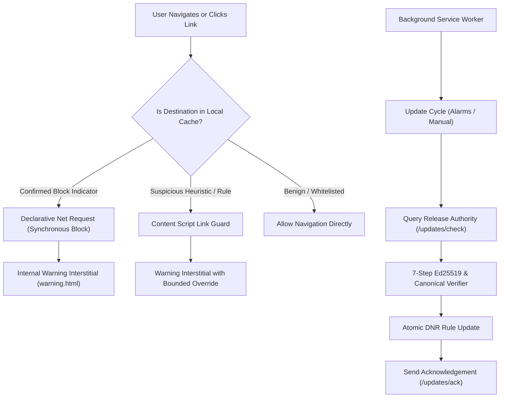

# CyberDuel AI — PC Browser Security Extension

## Status: Master Phase 7 Complete (Verified)

The CyberDuel Browser Extension provides ultra-low-latency, privacy-respecting client-side navigation protection for Chromium and Microsoft Edge browsers built on Manifest V3.

---

## 1. Core Architecture

The extension runs purely on the client edge using cached, cryptographically signed security policies and deterministic local analysis without requiring cloud connectivity for routine browsing.



---

## 2. Key Modules & Subsystems

| Module | Location | Purpose |
| :--- | :--- | :--- |
| **Manifest V3 Specification** | `manifest.json` | Minimal permissions (`storage`, `declarativeNetRequest`, `alarms`, `activeTab`), strict CSP without eval or remote code. |
| **Local Threat Engine** | `src/engine/threat-decision.ts` | Orchestrates URL normalization, indicator lookup, declarative rules, and heuristic scoring. |
| **URL Normalizer** | `src/engine/normalizer.ts` | Cross-language RFC 3986 / WHATWG parser, sensitive query parameter redactor, and canonicalizer. |
| **Heuristics & Features** | `src/engine/heuristics.ts`, `feature-extractor.ts` | Detects brand mimicry, embedded credentials, IP hosts, punycode deception, and suspicious TLDs. |
| **Declarative Rule Evaluator** | `src/engine/rule-evaluator.ts` | Evaluates declarative AST predicates (`eq`, `ne`, `gt`, `gte`, `lt`, `lte`, `contains`, `in`, `matches_regex`). |
| **DNR Compiler & Manager** | `src/dnr/compiler.ts`, `rule-manager.ts` | Compiles block indicators into `chrome.declarativeNetRequest` rules with atomic update and rollback. |
| **Cryptographic Verifier** | `src/crypto/verifier.ts`, `ed25519.ts`, `canonical.ts` | 7-step client-side verification pipeline matching Prompt 6 Ed25519 digital signatures and RFC 8785 canonical JSON. |
| **Policy & Settings Store** | `src/storage/policy-store.ts`, `settings-store.ts` | Manages active policy state, sequence numbers, ring-buffer evaluations, and user preferences in `chrome.storage.local`. |
| **Background Service Worker** | `src/background/service-worker.ts` | Coordinates message passing, alarms, update transactions, and DNR installation. |
| **Link Guard** | `src/content/link-guard.ts` | Content script intercepting user clicks on `<a>` tags with modifier-key awareness. |
| **User Interfaces** | `popup.html`, `options.html`, `warning.html` | Action popup, detailed options & onboarding portal, and secure warning interstitial. |

---

## 3. Unpacked Installation Guide (Chrome & Edge)

### Prerequisites
- Node.js >= 20.0.0
- npm >= 10.0.0

### Step 1: Build the Extension
```bash
cd apps/browser-extension
npm install
npm run build
```
This produces a self-contained, reviewed static bundle in `apps/browser-extension/dist/`.

### Step 2: Load Unpacked in Google Chrome
1. Open Google Chrome and navigate to `chrome://extensions/`.
2. Enable the **Developer mode** toggle in the top-right corner.
3. Click the **Load unpacked** button in the top-left menu.
4. Select the `apps/browser-extension/dist` folder inside this repository.
5. Confirm that **CyberDuel AI — Navigation Guard & Threat Defense** appears in your active extensions list.

### Step 3: Load Unpacked in Microsoft Edge
1. Open Microsoft Edge and navigate to `edge://extensions/`.
2. Enable the **Developer mode** toggle in the bottom-left sidebar.
3. Click **Load unpacked** in the top action bar.
4. Select the `apps/browser-extension/dist` folder.
5. The extension is now loaded and operational.

---

## 4. Local Development and Testing

```bash
# Type check all TypeScript files
npm run type-check

# Run Vitest test suite (39 tests)
npm run test

# Production build
npm run build
```

---

## 5. Security & Privacy Guarantees

1. **Zero Remote Code**: The extension contains zero `eval()`, zero `new Function()`, zero remote scripts, and zero WebAssembly bytecode from network sources.
2. **Strict Data Minimization**:
   - Page HTML is never collected or transmitted.
   - Form data, passwords, and session cookies are never accessed.
   - Default telemetry mode transmits only one-way SHA-256 target digests for lab triage.
3. **Supply-Chain Integrity**: Updates are rejected immediately if:
   - The publisher key is not in the active trust anchors or is revoked.
   - The Ed25519 detached signature does not match the canonical manifest.
   - Monotonic sequence numbers are replayed ($S_{new} \le S_{current}$).
   - The artifact SHA-256 digest fails integrity comparison.
4. **Resilient Offline Protection**: If the cloud API is unreachable, the extension seamlessly continues enforcing the cached, previously verified policy without degrading user browsing safety.
