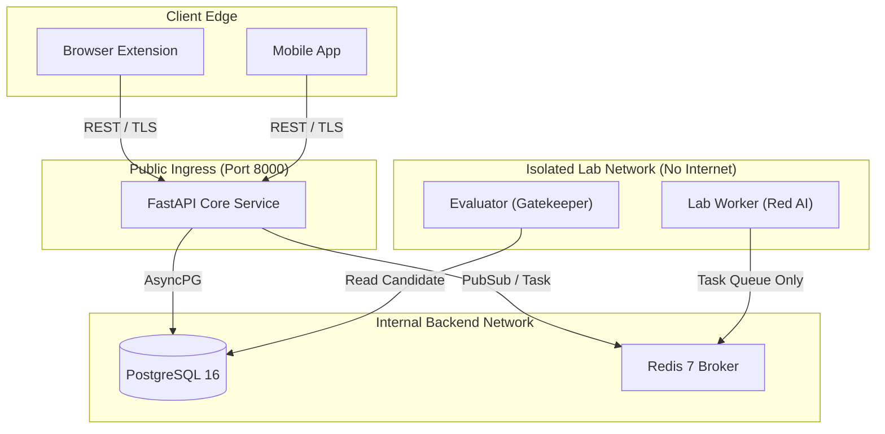

# CyberDuel AI — System Architecture Specification

## 1. Executive Summary

CyberDuel AI is a production-oriented, continuously improving cybersecurity defense platform. It pairs an adversarial AI cloud research laboratory with lightweight edge protection components across web browsers and mobile devices.

### Core Operating Principle
> **The research laboratory may experiment continuously; production defenses change only after independent validation and controlled release.**

---

## 2. Monorepo Structural Blueprint

```text
cyberduel-ai/
  apps/
    api/                     # FastAPI core backend service & routing
    dashboard/               # Security Operations & Research Console (Next.js 15)
    browser-extension/       # Chromium/Firefox client-side heuristic inspection engine
    mobile/                  # Mobile device protection companion application
  services/
    lab-worker/              # Sandboxed adversarial scenario simulator (Red AI)
    evaluator/               # Automated regression & benchmark validation runner
  packages/
    shared-contracts/        # Canonical Pydantic v2 schemas and domain enums
    threat-intelligence/     # Feed parsers, IOC normalizers, and threat categorizers
    policy-engine/           # Declarative rule matching and signature validation
  datasets/                  # Curated benchmark manifests and evaluation corpora
  infrastructure/            # Docker Compose, Postgres, Redis, and deployment configs
  scripts/                   # Developer automation and migration utilities
  docs/                      # Architecture, threat model, security model, API contracts
```

---

## 3. Subsystem Breakdown

### 3.1 Cloud Research Laboratory
The research laboratory contains two cooperating but adversarially evaluated agents:
1. **Red AI:** Generates or selects authorized synthetic threat scenarios (homograph attacks, lexical deceptions, evasive payload patterns) and probes the current defense system inside a strictly controlled, isolated laboratory.
2. **Blue AI:** Analyzes incoming telemetry and synthetic attacks, generates candidate defensive rules (declarative heuristics, regex patterns, feature weights), and packages them for audit.
3. **Independent Evaluation Engine:** Runs candidate defenses against a standardized regression test suite and fixed benign corpora. It validates that detection rates improve without introducing regressions or false positives.

### 3.2 Production API Service
The production API acts as the gateway between edge clients and the backend:
- Evaluates URLs and indicators in real time using the active verified policy.
- Ingests privacy-minimized telemetry without storing raw browsing histories.
- Distributes signed, declarative policy updates.

### 3.3 Edge Clients (Browser Extension & Mobile App)
- **Local First:** Run fast local checks using cached declarative policies.
- **Privacy First:** Queries to cloud use cryptographic hashes or privacy-minimized domain summaries.
- **Safe Updates:** Edge clients never execute remote scripts or unverified binary updates; updates consist exclusively of declarative rules and signed manifests.

### 3.4 Defensive Engine & Threat Intelligence Subsystem (Phase 2)
The threat intelligence subsystem (`packages/threat-intelligence`) operates both standalone and within the API service:
- **URL Normalizer & Validator:** Canonicalizes complex URLs, handles Punycode IDN homoglyphs, IPv4/IPv6, strips credentials, redacts sensitive tokens, and validates bounds.
- **Threat Intelligence Repository:** Lookups known malicious hashes across in-memory cache and persistent `threat_indicators` database table.
- **Heuristic Analyzer:** Evaluates 11 deterministic structural and lexical rules without requiring cloud AI APIs.
- **Explainable Scoring Engine:** Combines heuristic indicators and intelligence feeds using soft independence saturation ($S = 1.0 - \prod(1 - w_i)$), deduplicates evidence categories, and produces thresholded `allow`, `warn`, and `block` decisions.
- **Observation Pipeline:** Ingests privacy-conscious telemetry reports from edge clients, enforces lifecycle verification states (`received` -> `queued` -> `investigating` -> `confirmed` | `rejected`), and de-duplicates telemetry.
- **Policy Bundle Exporter:** Compiles active heuristic rules, thresholds, and whitelists into an integrity-digested bundle (`LocalProtectionPolicyBundle`) for offline edge enforcement.

### 3.5 Red AI Research Laboratory & Cyber Range (Phase 3)
The Red AI Research Laboratory (`services/lab-worker/app/red_ai`) acts as the controlled adversarial evaluation harness:
- **Threat Pattern Library:** Versioned catalog of synthetic threat patterns across 14 scenario families using reserved documentation domains and documentation IPs.
- **Scenario Generator:** Deterministic generation from random seeds guaranteeing that identical seeds reproduce identical corpora.
- **Scenario Mutation Engine:** Safe, bounded mutation operators (case variation, path depth, query injection, port injection, punycode/unicode swap, param reordering) with lineage tracking and explicit relabeling for semantic shifts.
- **Defensive Test Runner:** Directly evaluates scenarios through `URLAnalysisService` in-process without mock evasion or external network requests.
- **Failure Analyzer:** Groups detection discrepancies into actionable categories (`evasion`, `over_detection`, `policy_miscalibration`, `parsing_inconsistency`) and synthesizes investigation hypotheses.
- **Evaluation Handoff:** Transmits structured failure candidate packages to the Independent Evaluator and future Blue AI while strictly prohibiting Red AI from modifying production policies.

### 3.7 Independent Evaluation Engine & Autonomous Self-Improvement Controller (Phase 5)
The Independent Evaluator (`services/evaluator`) and Autonomous Self-Improvement Controller (`apps/api/app/services/improvement`) enforce strict scientific rigor and automated learning:
- **Standardized Benchmark Registry:** Curated suites split into 5 leakage-resistant subsets: `development`, `validation`, `regression`, `held_out`, and `benign_control`.
- **Zero-Regression Gate:** Rejects any candidate defense that introduces regressions on verified historical attack or benign scenarios.
- **Autonomous Controller:** Executes bounded 10-step self-improvement loops with timeout guardrails, budget limits, and persistent checkpoints.

### 3.8 Signed Security Update System & Cryptographic Authority (Phase 6)
The release management system (`apps/api/app/services/releases`) governs the distribution of updates to edge clients:
- **Ed25519 Detached Digital Signatures:** Manifests are serialized to canonical JSON (RFC 8785) and signed with isolated authority private keys.
- **Monotonic Sequence Enforcement:** Anti-replay protection enforcing strictly increasing sequence numbers ($S_{n+1} > S_n$).
- **7-Step Client Verification:** Validates trust anchors, digital signature, expiry, sequence, platform compatibility, and artifact SHA-256 digest before installation.
- **Verifiable Emergency Rollback:** Publishes signed rollback packages with incremented sequence numbers to rapidly restore previous trusted policies.

### 3.9 PC Browser Extension (Phase 7)
The browser extension (`apps/browser-extension`) operates in Chromium and Microsoft Edge using Manifest V3:
- **Declarative Net Request (DNR):** Synchronously blocks known malicious domains and paths without latency overhead.
- **Link Guard:** Content script inspecting DOM navigation events, checking URLs locally, and presenting user warning screens.
- **WebCrypto Verifier:** In-browser Ed25519 cryptographic verification matching backend standards.

### 3.10 Android Mobile Security Companion (Phase 8)
The native Android application (`apps/mobile`) protects mobile endpoints:
- **Offline Threat Engine:** On-device URL normalization, feature extraction, and declarative AST rule evaluation in Kotlin.
- **Share-to-Check Intent Filter:** Ingests URLs from any messaging or browser app via the Android system Share sheet with strict privacy token stripping.
- **Cryptographic Policy Verification:** Validates cloud updates using BouncyCastle Ed25519 and atomic JSON file persistence.

### 3.11 Unified Security Command Center (Phase 9)
The operations console (`apps/dashboard`) provides real-time visibility and management:
- **React 18 + Vite + Tailwind CSS:** Non-fabricated metrics directly queried from database and cache.
- **Server-Side RBAC:** Enforces role permissions across `viewer`, `research_operator`, `defense_reviewer`, `release_operator`, and `admin`.
- **Comprehensive Portals:** Overview, Red AI Lab, Blue AI Defense, Evaluator Audits, Releases & Rollouts, Client Fleet, Threat Intelligence, and Immutable Audit Logs.

### 3.12 Production Hardening, CI/CD & Railway Multi-Service Topology (Phase 10)
- **Path Traversal & DoS Mitigation:** Strict regex parameter binding and 1 MB streaming body limit middleware.
- **Multi-Service Railway Deployment:** Configured via `railway.json`, running `cyberduel-api`, `cyberduel-worker`, `cyberduel-dashboard`, PostgreSQL 16, and Redis 7 with persistent volume storage for release bundles.
- **Preflight Verification:** Automated validation via `scripts/railway_preflight.py` checking environment, storage writability, and subsystems without secret disclosure.
- **Continuous Integration:** GitHub Actions workflow (`.github/workflows/ci.yml`) validating all 242 monorepo tests across Python, TypeScript, and Kotlin.


---

## 4. Communication Topology & Network Boundaries



---

## 5. Technology Stack Specifications

- **Python Runtime:** CPython 3.12 (Pinned)
- **API Framework:** FastAPI 0.115+
- **Data Validation:** Pydantic 2.10+
- **Persistence:** PostgreSQL 16 via SQLAlchemy 2.0+ (asyncpg driver)
- **Database Migrations:** Alembic 1.14+
- **Task Queue & Caching:** Redis 7+
- **Containerization:** Docker & Docker Compose v2+
- **Testing:** Pytest 8.3+ with pytest-asyncio

