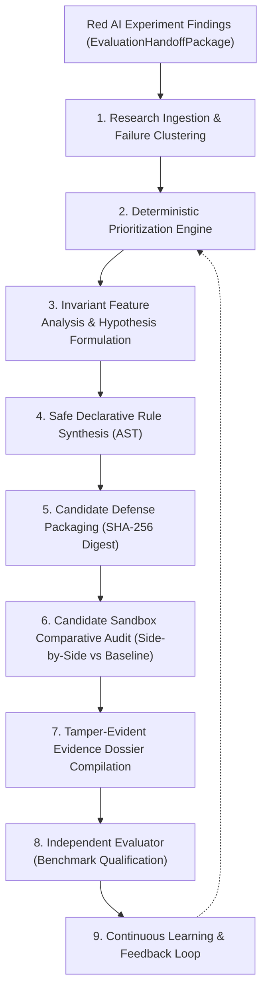

# CyberDuel AI — Blue AI Defense Engine Specification

## 1. Executive Summary & Purpose

The **Blue AI Defense Engine** is the defensive research component of CyberDuel AI. Its primary mission is to analyze detection blindspots identified during Red AI adversarial experiments and edge threat observations, formulate evidence-backed hypotheses explaining detector failures, synthesize safe declarative detection rules, and package candidate defenses for independent benchmark evaluation.

### Core Architectural Principle
> **The research laboratory experiments continuously; production defenses change only after independent validation and controlled release.**

Blue AI operates in an isolated development sandbox. It has **zero authority** to approve candidate defenses, mark hypotheses as facts, or deploy policy updates to production edge devices.



---

## 2. Component Architecture

### 2.1 Research Ingestion & Failure Clustering (`DefensiveResearchService`)
- **Location:** `apps/api/app/services/blue_ai/research.py`
- Ingests `EvaluationHandoffPackage` records from Red AI or queries `FailureFindingRecord` / `ScenarioRecord` from the database.
- Clusters individual discrepancies into coherent `FailureCluster`s grouped by `failure_category`, `scenario_family`, and `discrepancy_type`.
- Creates and persists persistent `ResearchTaskRecord`s in the database.

### 2.2 Mathematical Prioritization Engine (`DefensePrioritizationEngine`)
- **Location:** `apps/api/app/services/blue_ai/prioritizer.py`
- Prioritizes failure clusters to focus engineering attention where defensive impact is greatest:
  $$\text{PriorityScore} = (\text{SeverityWeight} \times \text{DiscrepancyMultiplier}) + \min(0.35, \log_{10}(\text{Count} + 1) \times 0.25) - \text{RejectionPenalty}$$
  - **Severity Weights:** `critical: 1.00`, `high: 0.80`, `medium: 0.50`, `low: 0.25`.
  - **Discrepancy Multipliers:** `false_negative: 1.30` (urgent defense gap), `evasion: 1.20`, `underclassification: 1.10`, `false_positive: 0.90`.
  - **Historical Rejection Penalty:** $-0.15$ if previous proposals in this category failed evaluation due to regressions or elevated false positives.

### 2.3 Hypothesis Formulation Engine (`DefenseHypothesisEngine`)
- **Location:** `apps/api/app/services/blue_ai/hypothesis.py`
- Analyzes invariant features across failing scenario URLs using `URLFeatureExtractor` and `URLValidator`:
  - Inspects IDN Punycode prefixes (`is_punycode`), raw IP literals (`is_ip_literal`), subdomain chaining (`subdomain_count \ge 3`), disposable TLDs (`.top`, `.xyz`, `.buzz`), and host entropy (`host_entropy \ge 3.0`).
- Generates structured `DefensiveHypothesis` records containing:
  - Observed behavior vs expected behavior.
  - Explanatory rationale of baseline detector blindspot.
  - Supporting evidence URLs and curated benign counterexamples.
  - Proposed intervention specifications and confidence scoring.

### 2.4 Safe Declarative AST Rule Engine (`DeclarativeRuleEngine`)
- **Location:** `packages/policy-engine/cyberduel_policy_engine/rules.py`
- Strict AST compile-time validator:
  - **Allowlisted Features Only (20):** `url_length`, `host_length`, `path_length`, `query_length`, `subdomain_count`, `path_depth`, `has_embedded_credentials`, `is_ip_literal`, `is_punycode`, `brand_token_detected`, `has_non_standard_port`, `has_double_encoding`, `phish_keyword_count`, `host_entropy`, `scheme`, `host`, `unicode_host`, `port`, `domain`, `is_whitelisted`.
  - **Safe Deterministic Operators Only (9):** `eq`, `ne`, `gt`, `gte`, `lt`, `lte`, `contains`, `in`, `matches_regex`.
  - **ReDoS Prevention:** Bounded regex pattern length ($\le 128$ chars), nested quantifier rejection (`(\+ * \+*)`), pre-compiled syntax validation.
  - **Complexity Ceilings:** Maximum 10 predicates per rule, bounded nesting depth $\le 4$.
  - **Safety Invariant:** Absolutely **zero** use of `eval()`, `exec()`, arbitrary code evaluation, or shell execution.
  - **Conflict Analysis:** Detects contradictory actions on identical predicate sets and duplicate rule signatures.

### 2.5 Candidate Detector Sandbox (`CandidateDetectorSandbox`)
- **Location:** `packages/policy-engine/cyberduel_policy_engine/sandbox.py` & `apps/api/app/services/blue_ai/sandbox_runner.py`
- Runs isolated comparative audits of candidate defenses alongside the active baseline detector:
  - Evaluates against failing scenario fixtures, 8 curated standard benign controls, and 4 regression benchmarks.
  - Computes:
    - `candidate_fixed_failure`: Baseline was wrong, candidate made expected decision.
    - `is_regression`: Baseline was correct, candidate deviated to wrong decision.
    - `is_new_false_positive`: Benign URL mistakenly flagged by candidate.
    - Confusion matrices, accuracy, recall, FPR, and F1.
  - Emits preliminary verdicts:
    - `promoted_for_evaluation`: Regressions $= 0$, Candidate FPR $\le 5.0\%$, and Failures Fixed $> 0$.
    - `rejected_regressive`: Regressions $> 0$ or Candidate FPR $> 8.0\%$.
    - `inconclusive`: Insufficient evidence or no net improvement.

### 2.6 Tamper-Evident Evidence Dossier (`DefenseEvidenceService`)
- **Location:** `apps/api/app/services/blue_ai/evidence.py`
- Bundles full provenance metadata, originating experiment IDs, hypothesis ASTs, rule definitions, sandbox confusion matrices, and safety checklists into an immutable JSON document.
- Computes a canonical SHA-256 evidence fingerprint:
  $$\text{DossierFingerprint} = \text{SHA256}(\text{CanonicalJSON}(\text{Dossier}))$$

### 2.7 Independent Evaluator Integration & Feedback Loop
- **Location:** `apps/api/app/services/blue_ai/handoff.py` & `feedback.py`
- Submits candidate defense to `BenchmarkEvaluator` in `services/evaluator`.
- Enforces strict boundary:
  - If Evaluator returns `PASS`: Candidate status updated to `approved`.
  - If Evaluator returns `FAIL`: Candidate status updated to `rejected`.
- Records historical verdicts in `CandidateFeedbackRecord`s and updates memory store to prevent repeating failed rule patterns.

---

## 3. REST API Reference (`/api/v1/blue/*`)

| Method | Endpoint | Description |
| :--- | :--- | :--- |
| `GET` | `/api/v1/blue/status` | Discovers Blue AI operational status, active tasks, candidates built, and acceptance rate. |
| `POST` | `/api/v1/blue/research` | Ingests Red AI handoff package or loads experiment findings from DB to start research. |
| `GET` | `/api/v1/blue/research/{task_id}` | Retrieves details, failure clusters, and hypotheses for a research task. |
| `GET` | `/api/v1/blue/failure-groups` | Lists ranked and prioritized failure clusters across recent experiments. |
| `POST` | `/api/v1/blue/candidates` | Synthesizes declarative rules, packages candidate defense, and executes sandbox audit. |
| `GET` | `/api/v1/blue/candidates/{id}` | Retrieves candidate defense metadata and compiled rule specifications. |
| `GET` | `/api/v1/blue/candidates/{id}/comparison` | Retrieves side-by-side sandbox comparison report against baseline. |
| `POST` | `/api/v1/blue/candidates/{id}/evaluate` | Submits candidate defense to independent benchmark evaluation. |
| `GET` | `/api/v1/blue/history` | Retrieves historical audit trail of candidates, verdicts, and regression metrics. |

---

## 4. Blue AI CLI Reference (`scripts/blue_cli.py`)

The CLI provides offline researcher and administrative workflows:

```bash
# 1. Ingest findings and cluster failure gaps
python scripts/blue_cli.py research -o artifacts/research_task.json

# 2. Synthesize hypothesis and declarative rule
python scripts/blue_cli.py propose -c homoglyph_spoofing -o artifacts/candidate_defense.json

# 3. Execute isolated candidate sandbox comparative audit
python scripts/blue_cli.py test-sandbox -c artifacts/candidate_defense.json -o artifacts/sandbox_comparison.json

# 4. Submit candidate to independent benchmark evaluator
python scripts/blue_cli.py evaluate -c artifacts/candidate_defense.json

# 5. Run full 10-stage autonomous cycle end-to-end
python scripts/blue_cli.py cycle -o artifacts/cycle_summary.json

# 6. Display learning memory status
python scripts/blue_cli.py status
```

---

## 5. Security & Safety Invariants

1. **Zero Dynamic Code Execution:** All defense updates are purely declarative AST data structures evaluated by `DeclarativeRuleEngine`. The system strictly prohibits `eval()`, `exec()`, or subshell execution.
2. **ReDoS Immunity:** Regex patterns are length-bounded ($\le 128$ chars), validated at compile time, and inspected for catastrophic backtracking patterns (nested quantifiers).
3. **No Direct Production Mutation:** Blue AI operates exclusively in sandbox evaluation. Candidates must pass independent benchmark validation by `BenchmarkEvaluator` before release qualification.
4. **Audit Immutability:** Every candidate package receives a canonical SHA-256 digest, and every evidence dossier receives an immutable cryptographic fingerprint.

