# CyberDuel AI — Browser Extension Architecture & Edge Security Manual

## 1. Architectural Overview

The **CyberDuel AI Browser Extension** provides real-time, privacy-respecting client-side navigation protection for Chromium-based browsers (Google Chrome, Microsoft Edge) conforming to the **Manifest V3** specification.

The extension operates on a **zero-trust local verification principle**: all navigation checks are resolved locally against a cached, cryptographically signed policy bundle. Network round-trips to the cloud research lab are only initiated for periodic background update checks, user-initiated disputes, or optional privacy-minimized telemetry.

```mermaid
flowchart TD
    subgraph Client Browser Process
        Tab["Web Page Navigation / Link Click"] --> ContentScript["Content Script Link Guard (link-guard.ts)"]
        ContentScript -- "Query Decision" --> SW["Service Worker (service-worker.ts)"]
        SW --> Engine["Local Threat Decision Engine"]
        Engine --> Normalizer["RFC 3986 URL Normalizer"]
        Normalizer --> IndicatorCheck{"Exact Indicator Match?"}
        IndicatorCheck -- "Match (Action: Block)" --> BlockVerdict["Return BLOCK"]
        IndicatorCheck -- "No Match" --> AST["Declarative AST Rule Evaluator"]
        AST --> Heuristics["Heuristic Analyzer (Mimicry, Entropy, Punycode)"]
        Heuristics --> Calibrate["Risk Calibrator & Decision Thresholds"]
        
        SW -- "Synchronous Filter" --> DNR["declarativeNetRequest Dynamic Rules"]
        DNR -- "Network Match" --> WarningPage["Internal Warning Interstitial (warning.html)"]
    end

    subgraph Background Update Lifecycle
        Alarm["Periodic Alarm (30 min)"] --> UpdateManager["Update Manager"]
        UpdateManager --> ReleaseAPI["Backend /api/v1/updates/*"]
        ReleaseAPI -- "Signed Manifest & Bundle" --> Verifier["7-Step Client Update Verifier"]
        Verifier --> CryptoCheck{"Ed25519 & Anti-Replay Valid?"}
        CryptoCheck -- "Valid" --> DNRCompiler["Compile Dynamic DNR Rules"]
        DNRCompiler --> StoreCommit["Commit to chrome.storage.local"]
        StoreCommit --> Ack["Send Receipt /api/v1/updates/ack"]
        CryptoCheck -- "Invalid" --> Rollback["Retain Current Trusted Policy"]
    end
```



---

## 2. Manifest V3 Security Boundary & Permissions

The extension adheres strictly to the principle of least privilege:

| Permission | Technical Requirement | Security Impact & Mitigation |
| :--- | :--- | :--- |
| `storage` | Storing active policy bundle, sequence counter, and user settings. | Scoped to extension origin; inaccessible to external web pages. |
| `declarativeNetRequest` | Synchronously blocking network requests matching verified threat indicators. | Native browser process execution; zero overhead and no script injection. |
| `alarms` | Scheduling periodic background update checks (every 30 minutes). | Eliminates permanent background worker persistence, saving battery and memory. |
| `activeTab` | Inspecting active tab URL on demand when the user clicks the popup. | Ephemeral permission granted only upon explicit user invocation of the action popup. |
| `<all_urls>` | Required for DNR rules and Link Guard to protect user across arbitrary domains. | Explaining clearly in the Options and Onboarding portal; zero browsing history retained. |

### Content Security Policy (CSP)
```json
{
  "extension_pages": "script-src 'self'; object-src 'self';"
}
```
Remote code execution (`eval()`, `new Function()`, CDN script tags, external WebAssembly) is completely forbidden and structurally impossible.

---

## 3. Local URL Threat Engine

The local detection engine runs synchronously in sub-millisecond timeframes:

1. **RFC 3986 / WHATWG Normalizer (`src/engine/normalizer.ts`)**:
   - Scheme filtering (strictly `http` and `https`).
   - Hostname lowercasing and trailing dot removal (`EXAMPLE.COM.` -> `example.com`).
   - Credential stripping (`user:pass@host` -> userinfo `user:[REDACTED]`, canonical `host`).
   - IPv4 and IPv6 literal canonicalization.
   - Punycode detection and Internationalized Domain Name handling.
   - Query string canonicalization and sensitive token redaction (`token`, `api_key`, `password`, `session`).
   - Resolves RFC 3986 dot segments in paths (`/a/b/../c` -> `/a/c`).
   - Canonical SHA-256 digests (`url_sha256` and `domain_sha256`).

2. **Threat Indicators Lookup**:
   - Evaluates `url_sha256` and `domain_sha256` against compiled indicators from `threat_indicators`.
   - Matching a block indicator immediately issues a high-confidence `block` decision with `threat_intelligence` provenance.

3. **Declarative Rule Engine (`src/engine/rule-evaluator.ts`)**:
   - Evaluates pure AST predicates against 19 structural features.
   - Operators: `eq`, `ne`, `gt`, `gte`, `lt`, `lte`, `contains`, `in`, `matches_regex`.
   - Bounded execution: max 10 predicates per rule, max 128 characters per regex, zero recursion.

4. **Heuristic Analyzer (`src/engine/heuristics.ts`)**:
   - High-value brand impersonation (17 major brands, e.g. PayPal, Microsoft, Apple, Google, Binance, Chase) on non-official domains.
   - Raw IP literal host detection.
   - Suspicious TLD detection (`.tk`, `.ml`, `.ga`, `.cf`, `.gq`, `.top`, `.buzz`, `.icu`, `.rest`, `.work`).
   - Host lexical entropy calculation (Shannon entropy threshold > 4.2).
   - Known-good whitelist bypass for top-tier trusted domains (e.g. `google.com`, `apple.com`, `github.com`, `wikipedia.org`).

---

## 4. Declarative Net Request (DNR) Compilation & Quotas

To enforce network-level blocking before TCP/TLS handshakes:
- `DNRCompiler` compiles confirmed indicators into Chrome dynamic rules.
- Rule IDs are deterministically mapped starting from base ID `10000`.
- Quota handling: Chrome enforces dynamic rule limits; CyberDuel bounds dynamic rules to a maximum of 5,000 rules.
- Atomic updates: `DNRRuleManager.installPolicyRules()` swaps old dynamic rules for new rules in a single call to `chrome.declarativeNetRequest.updateDynamicRules()`. If an error occurs, it automatically rolls back to previous rules.

---

## 5. Cryptographic Supply-Chain Verification (7 Checkpoints)

Before any downloaded policy update is activated, `ClientUpdateVerifier` executes the mandatory 7-step pipeline:

```
[Release Candidate]
       │
       ▼
 [Step 1: Trust Anchor Verification] ────► Reject if publisher key is unknown or revoked
       │
       ▼
 [Step 2: Digital Signature] ────────────► Reject if Ed25519 signature over canonical manifest is invalid
       │
       ▼
 [Step 3: Anti-Replay Ordering] ─────────► Reject if Sequence(new) <= Sequence(current) [unless rollback]
       │
       ▼
 [Step 4: Version Compatibility] ────────► Reject if client/engine version is below required minimum
       │
       ▼
 [Step 5: Expiration Cutoff] ────────────► Reject if Date.now() > manifest.expires_at
       │
       ▼
 [Step 6: Artifact Integrity] ───────────► Reject if SHA-256(raw_bytes) != manifest.artifact_digest
       │
       ▼
 [Step 7: Bundle AST Safety] ────────────► Reject if unallowlisted operators or unbounded regex present
       │
       ▼
 [Active Policy Committed & DNR Installed]
```

### Monotonic Rollback Recovery
If an update is flagged with `is_rollback: true`, it carries an incremented sequence number ($S_{rollback} > S_{current}$) and packages a known-good policy bundle. The edge client advances to the higher sequence number while safely reverting the active detection rules to the previous stable baseline.

---

## 6. Privacy & Data Minimization Protocol

- **Telemetry Modes**:
  - `minimal` (Default): Only one-way irreversible SHA-256 digests (`normalized_identifier`), domain, and local verdict are sent.
  - `disabled`: All cloud transmission is halted. The extension functions in pure air-gapped local mode.
  - `full_url`: User explicit opt-in for laboratory research.
- **Strict Invariants**:
  - Never collect page HTML or DOM contents.
  - Never collect form input, cookies, or HTTP headers.
  - Query parameters with sensitive names (`token`, `auth`, `password`, `key`, `jwt`, `session`) are redacted prior to hashing or reporting.
  - Ring buffer of recent evaluations is strictly ephemeral (max 20 items in `chrome.storage.local`) and is never synchronized to the cloud.

---

## 7. Known Browser Constraints

1. **Omnibox Typed Navigation**: In Manifest V3, extensions cannot intercept typed URLs before navigation begins unless they match pre-installed declarative DNR rules. User link clicks are protected via Link Guard.
2. **Dynamic Rule Capacity**: The browser limits dynamic DNR rules to ~30,000 across all installed extensions. CyberDuel reserves up to 5,000 rules.
3. **Service Worker Inactivity**: Manifest V3 service workers terminate when idle. All critical state is stored in `chrome.storage.local` and reconciled immediately upon waking.

