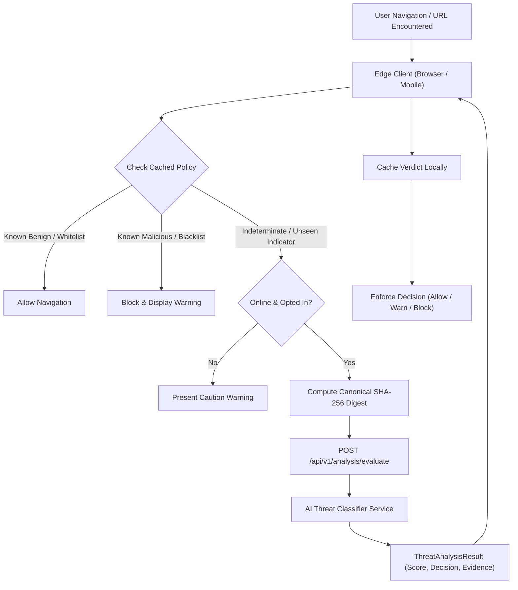
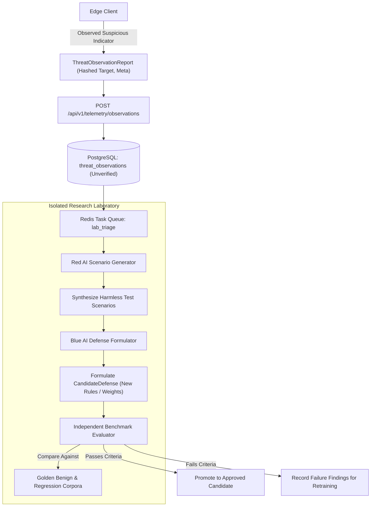
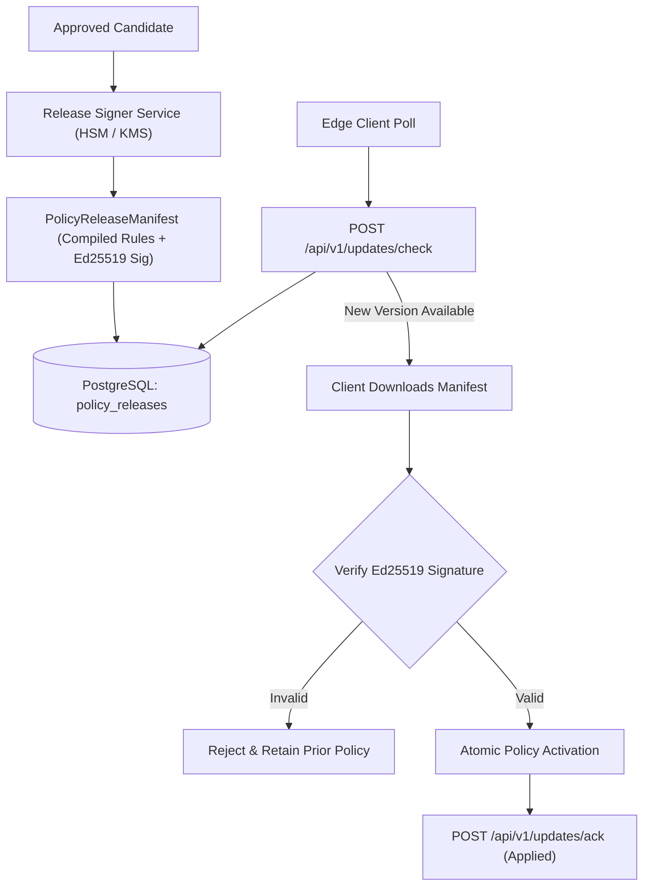
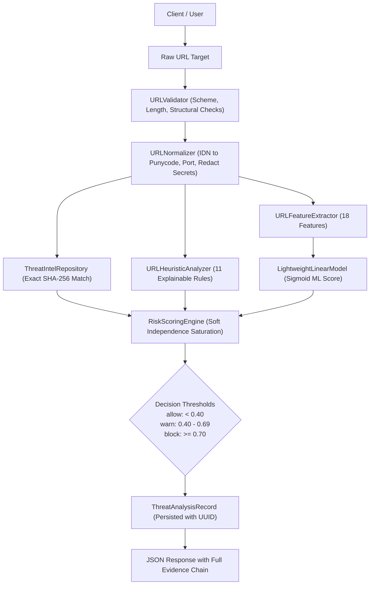
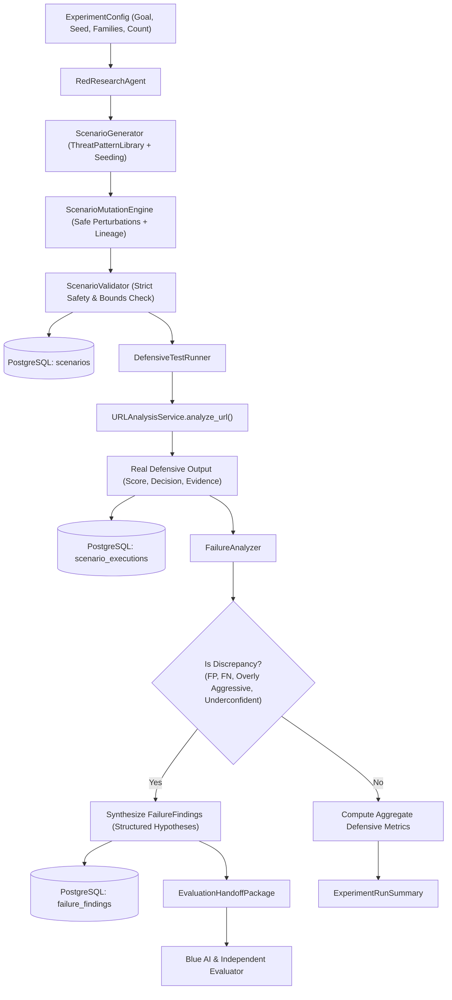
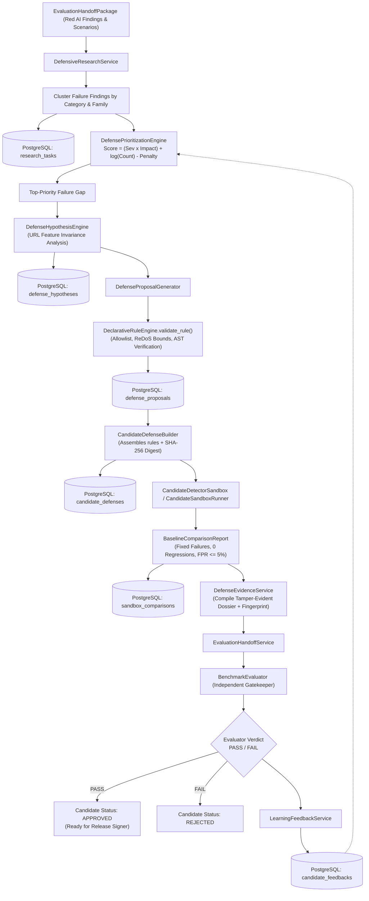
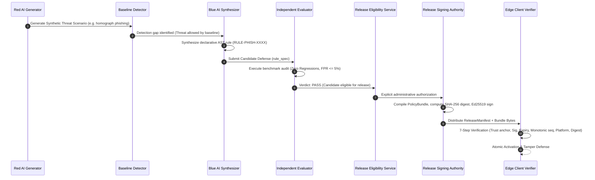

# CyberDuel AI — End-to-End Data Flow Architecture

## 1. Real-Time Detection Data Flow

---

## 2. Telemetry Ingestion & Laboratory Research Flow

---

## 3. Cryptographic Policy Release & Distribution Flow

---

## 4. Explainable URL Analysis & Observation Flow (Phase 2)

---

## 5. Red AI Adversarial Testing & Failure Handoff Flow (Phase 3)

---

## 6. Blue AI Autonomous Research & Candidate Submission Flow (Phase 4)

---

## 7. Authoritative Research-to-Release Lifecycle & Client Verification Flow (Phase 10)

