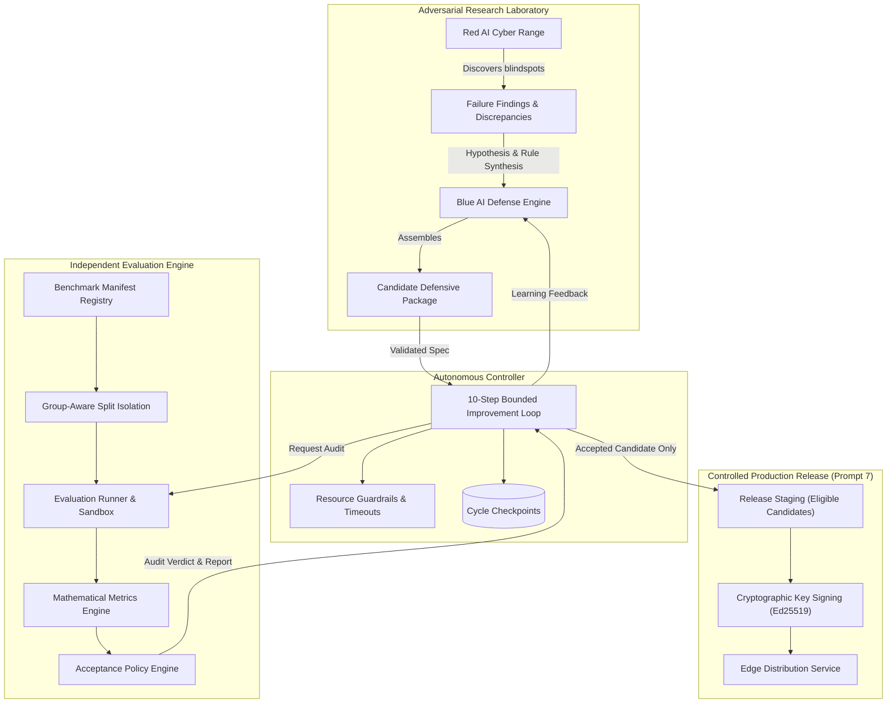
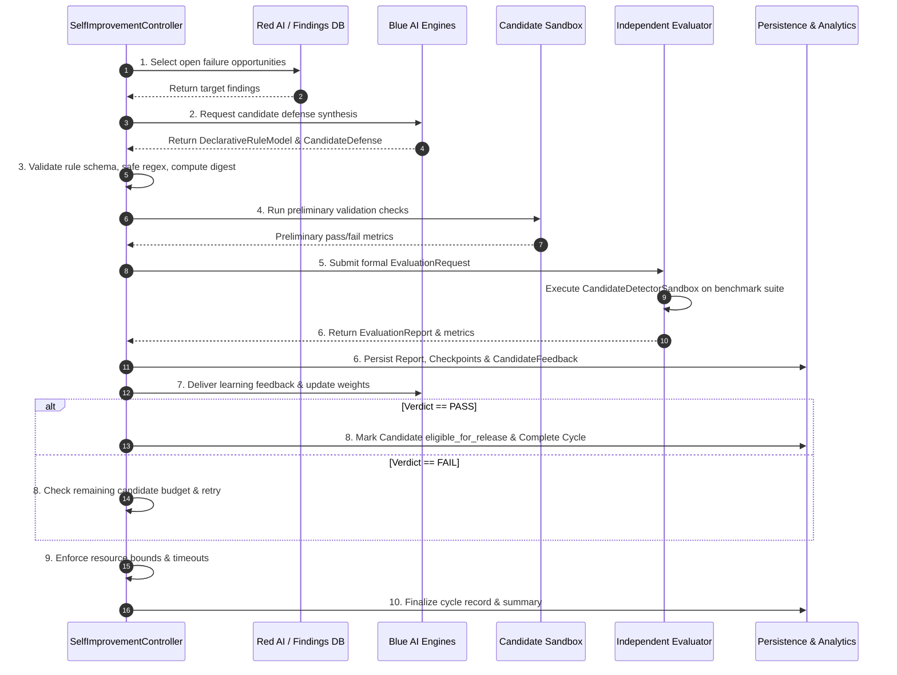

# CyberDuel AI — Independent Evaluation Engine & Autonomous Self-Improvement Controller

## 1. Executive Architecture & Separation of Concerns

CyberDuel AI operates on the fundamental operating principle:

> **"The research laboratory may experiment continuously; production defenses change only after independent validation and controlled release."**

To maintain scientific integrity and prevent self-reinforcing bias, the platform enforces strict structural and logical boundaries between four distinct subsystems:



1. **Red AI Cyber Range:** Generates safe, synthetic, labeled adversarial threat scenarios and benign lookalikes in an isolated range. Identifies detection discrepancies.
2. **Blue AI Defense Engine:** Investigates Red AI failures, extracts feature invariants, formulates hypotheses, synthesizes declarative rules, and tests candidate packages in an isolated local sandbox. Blue AI possesses **zero** authority to approve its own candidate defenses.
3. **Independent Evaluation Engine (`services/evaluator/`):** A standalone auditing authority that evaluates candidate defenses against immutable, frozen benchmark suites without exposing ground-truth labels to candidate code. It computes objective mathematical metrics and evaluates strict acceptance gates.
4. **Autonomous Self-Improvement Controller (`apps/api/app/services/improvement/`):** Coordinates the continuous research loop across Red AI, Blue AI, and the Evaluator under strict resource bounds, cycle timeouts, deduplication checks, and safe stopping conditions.
5. **Production Boundary:** Blue AI and the controller do **NOT** modify or release production defenses directly. When an evaluation verdict is `PASS`, the candidate is marked as `eligible_for_release` for the downstream release-management service.

---

## 2. Leakage-Resistant Benchmark Partitioning

The Independent Evaluation Engine eliminates data contamination, trivial memorization, and label leakage by organizing benchmark datasets into five disjoint, versioned splits:

| Split Name | Percentage | Purpose | Visibility to Blue AI |
| :--- | :---: | :--- | :--- |
| `development` | 30% | Used by Blue AI during initial hypothesis prototyping and rule formulation | Fully Visible |
| `validation` | 20% | Used for preliminary sandbox sanity checks before formal audit submission | Visible for validation |
| `regression` | 20% | Frozen, canonical benchmarks (known attacks & historical threats) that must never fail | Hidden during synthesis |
| `held_out` | 20% | Completely unseen threat mutations evaluating true generalization performance | Strictly Hidden |
| `benign_control` | 10% | Verified high-volume benign traffic ensuring zero false positive alarms | Strictly Hidden |

### Group-Aware Split Isolation Algorithm

Simple random splitting introduces subtle data leakage when mutated variations of a base domain or phishing campaign appear in both training and evaluation splits. 

The `BenchmarkRegistry.validate_split_isolation()` algorithm enforces two mandatory rules:
1. **URL Uniqueness:** No identical normalized URL may exist in more than one split:
   $$\text{URLs}(S_i) \cap \text{URLs}(S_j) = \emptyset \quad \forall i \neq j$$
2. **Group / Lineage Isolation:** Each scenario is tagged with a `group_id` representing its root domain, phishing campaign cluster, or synthetic mutation lineage. No group may overlap between training (`development`, `validation`) and evaluation (`held_out`, `regression`):
   $$\text{Groups}(\text{Train}) \cap \text{Groups}(\text{Eval}) = \emptyset$$

Any benchmark manifest violating these rules is immediately rejected during registration.

---

## 3. Real Detector Execution & Mathematical Metrics Engine

The Independent Evaluation Engine executes the actual `CandidateDetectorSandbox` alongside the baseline `URLAnalysisService` on real benchmark URLs. **No metrics are simulated, mocked, or fabricated.**

### Decision Mapping & Label Uncertainty

Scenarios are audited against three-way decisions (`allow`, `warn`, `block`) and ground-truth classes (`benign`, `suspicious`, `malicious`, `uncertain`):

- **Threat Mitigation (Positive Detection):**
  A scenario where $\text{Actual Decision} \in \{\text{block}, \text{warn}\}$ on a ground-truth $\text{Class} \in \{\text{malicious}, \text{suspicious}\}$ is counted as a **True Positive (TP)**.
- **Threat Miss (False Negative):**
  A scenario where $\text{Actual Decision} = \text{allow}$ on a ground-truth $\text{Class} \in \{\text{malicious}, \text{suspicious}\}$ is counted as a **False Negative (FN)**.
- **Benign Protection (True Negative):**
  A scenario where $\text{Actual Decision} = \text{allow}$ on a ground-truth $\text{Class} = \text{benign}$ is counted as a **True Negative (TN)**.
- **False Alarm (False Positive):**
  A scenario where $\text{Actual Decision} \in \{\text{block}, \text{warn}\}$ on a ground-truth $\text{Class} = \text{benign}$ is counted as a **False Positive (FP)**.
- **Label Uncertainty:**
  Scenarios with `expected_class = "uncertain"` (e.g. semantic mutations where threat status is ambiguous) are recorded and analyzed separately without contaminating binary classification metrics.

### Mathematical Formulas

$$\text{Precision} = \frac{\text{TP}}{\text{TP} + \text{FP}}$$

$$\text{Recall (Detection Rate)} = \frac{\text{TP}}{\text{TP} + \text{FN}}$$

$$F_1 = 2 \times \frac{\text{Precision} \times \text{Recall}}{\text{Precision} + \text{Recall}}$$

$$\text{FPR (False Positive Rate)} = \frac{\text{FP}}{\text{FP} + \text{TN}}$$

$$\text{FNR (False Negative Rate)} = \frac{\text{FN}}{\text{FN} + \text{TP}}$$

$$\text{Accuracy} = \frac{\text{TP} + \text{TN}}{\text{TP} + \text{FP} + \text{TN} + \text{FN}}$$

### Operational Impact Metrics

During benchmark execution, the engine measures real execution latency and operational overhead:
- **Mean Latency ($\text{ms}$):** Average time per URL inspection.
- **P95 Latency ($\text{ms}$):** 95th percentile latency bound under load.
- **Error Rate & Timeouts:** Exact count of runtime parser errors or unhandled exceptions.

---

## 4. Multi-Gate Acceptance Policy Engine

Candidate defense promotion is governed by the `AcceptancePolicyEngine`, which enforces six strict, non-negotiable security gates:

| Gate | Criterion | Default Threshold | Failure Outcome |
| :--- | :--- | :---: | :--- |
| **1. Integrity Gate** | Rule AST schema validity, allowlist compliance, ReDoS safety, SHA-256 digest | Required | Immediate Rejection |
| **2. Regression Gate** | New regressions on baseline-correct benchmarks | $\le 0$ | Immediate Rejection |
| **3. False Positive Ceiling** | False Positive Rate ($\text{FPR}$) on benign controls | $\le 5.0\%$ | Immediate Rejection |
| **4. Target Resolution Gate** | Target Red AI failure cases resolved by candidate | $\ge 1$ | Rejection (Ineffective) |
| **5. Generalization Gate** | $F_1$ score on unseen `held_out` split | $\ge 0.70$ | Rejection (Overfit) |
| **6. Operational Budget Gate** | Mean latency overhead $\le 25\text{ ms}$; Error rate $= 0.0\%$ | Required | Rejection (Overhead) |

### Terminal Verdicts
- `PASS` / `ACCEPTED`: All gates passed. Candidate is marked as `eligible_for_release`.
- `FAIL` / `REJECTED`: One or more gates failed. Rejection reasons and detailed feedback are compiled.
- `INCONCLUSIVE`: Insufficient test cases or ambiguous benchmark results.

---

## 5. 10-Step Autonomous Self-Improvement Loop

The `SelfImprovementController` automates the research lifecycle while guaranteeing bounded resource consumption:



### Resource Guardrails & Safe Stopping
- `max_candidates_per_cycle`: Strict ceiling (default 5) on candidate defenses tested per cycle.
- `cycle_timeout_seconds`: Hard wall-clock timeout (default 120s) preventing hanging execution.
- `deduplication`: Candidate rule digests are hashed; identical rule sets are never re-evaluated.
- **Safe Stopping States:**
  - `COMPLETED`: Target improvement verified and promoted to release-eligible.
  - `STOPPED_BUDGET_EXHAUSTED`: Candidate budget or timeout reached without finding a passing defense.
  - `STOPPED_NO_PROGRESS`: No open failure findings or Blue AI unable to hypothesize remedies.
  - `FAILED`: Unhandled system error encountered.

---

## 6. Database Schema Extensions (Migration 0005)

The database schema is extended with eight tables supporting auditing and autonomous self-improvement:

1. `evaluation_protocols`: Standardized audit protocols, metric requirements, and threshold specifications.
2. `benchmark_manifests`: Versioned benchmark manifests, scenario payloads, family/split distributions, and SHA-256 integrity hashes.
3. `acceptance_policies`: Configurable acceptance gate criteria sets.
4. `evaluation_requests`: Queued and running independent evaluation tasks.
5. `evaluation_reports`: Immutable audit reports with full confusion matrices, split metrics, operational latency, and cryptographic digests.
6. `improvement_cycles`: Lifecycle tracking for each autonomous 10-step self-improvement loop.
7. `cycle_checkpoints`: Fine-grained, step-by-step state checkpoints for full auditability.
8. `cycle_feedbacks`: Learning feedback records linking evaluation verdicts back to future research cycles.

---

## 7. CLI & API Operational Reference

### CLI Tools

#### Independent Evaluator CLI (`scripts/evaluator_cli.py`)
```bash
# List all registered benchmark manifests
python scripts/evaluator_cli.py benchmarks

# Audit benchmark split isolation and detect data leakage
python scripts/evaluator_cli.py validate-splits --manifest-id benchmark-golden-v1

# Run independent benchmark audit on candidate defense
python scripts/evaluator_cli.py evaluate --version 0.3.0-candidate --manifest-id benchmark-golden-v1
```

#### Self-Improvement Controller CLI (`scripts/controller_cli.py`)
```bash
# Run a bounded autonomous self-improvement cycle
python scripts/controller_cli.py run-cycle --max-candidates 3 --timeout 90

# List historical improvement cycles
python scripts/controller_cli.py list-cycles --limit 10

# Inspect step-by-step checkpoints for a specific cycle
python scripts/controller_cli.py cycle-details --cycle-id <CYCLE_UUID>

# Display longitudinal trend report
python scripts/controller_cli.py trend-report
```

### REST API Endpoints

| Method | Endpoint | Description |
| :--- | :--- | :--- |
| `POST` | `/api/v1/evaluations` | Submit candidate defense for independent benchmark evaluation |
| `GET` | `/api/v1/evaluations` | List historical evaluation requests and verdicts |
| `GET` | `/api/v1/evaluations/benchmarks` | List registered benchmark manifests |
| `GET` | `/api/v1/evaluations/benchmarks/{id}` | Retrieve benchmark manifest details and split counts |
| `GET` | `/api/v1/evaluations/{id}` | Get evaluation request summary |
| `GET` | `/api/v1/evaluations/{id}/report` | Retrieve full detailed `EvaluationReport` |
| `GET` | `/api/v1/evaluations/{id}/metrics` | Retrieve confusion matrix and operational latency breakdown |
| `POST` | `/api/v1/improvement/cycles` | Launch an autonomous self-improvement loop cycle |
| `GET` | `/api/v1/improvement/cycles` | List past improvement cycles |
| `GET` | `/api/v1/improvement/cycles/{id}` | Get cycle summary with all step checkpoints |
| `POST` | `/api/v1/improvement/cycles/{id}/cancel` | Cancel an active improvement cycle |
| `GET` | `/api/v1/improvement/history` | Longitudinal trend analytics across cycles |
| `GET` | `/api/v1/improvement/status` | Current controller state (active cycles, budget) |

