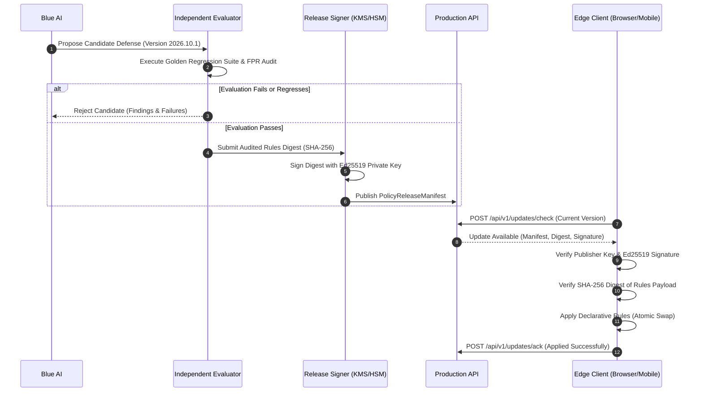

# CyberDuel AI — Security Model & Sandbox Architecture

## 1. Core Security Tenets

1. **Isolation of Adversarial Workloads:** The research laboratory experiments continuously with synthetic threats. It has zero connectivity to the public internet, no host socket mounts, and dropped Linux capabilities.
2. **Immutable Release Gatekeeping:** Production defenses never change directly from an AI prompt or automated suggestion. A candidate defense must pass the Independent Evaluator before signing.
3. **Declarative Updates Only:** Production edge clients **never execute arbitrary remote code or scripts**. Threat intelligence and policy updates are restricted to declarative regex sets, bloom filters, and structured rulesets.
4. **Key Separation:** Private keys for signing policy releases are stored in Hardware Security Modules (HSM) or dedicated KMS vaults, completely inaccessible to AI agent containers.

---

## 2. Laboratory Sandboxing Architecture

Docker Compose provides basic container isolation, but **Docker containers alone do not constitute a complete security boundary for untrusted or hostile execution**.

```
+-------------------------------------------------------------------------------+
|                             HOST OS KERNEL                                    |
+-------------------------------------------------------------------------------+
       |                                                 |
  [Bridge Net]                                   [Isolated Bridge Net]
       |                                                 |
+--------------+     +-------------+             +-------------------------------+
|  FastAPI     |     |  Postgres   |             |  LAB WORKER CONTAINER         |
|  Container   |     |  Container  |             |  - User: labworker (UID 20001)|
|  (Port 8000) |     |  (Internal) |             |  - Cap Drop: ALL              |
+--------------+     +-------------+             |  - No New Privileges          |
                                                 |  - Outbound Internet: BLOCKED |
                                                 |  - No Host Socket Mount       |
                                                 |  - Resource Limits: 1 CPU/512M|
                                                 +-------------------------------+
                                                                 |
                                                    [Future: gVisor / Firecracker]
```

### Sandbox Hardening Measures:
- **No Host Docker Socket:** The Docker daemon socket (`/var/run/docker.sock`) is strictly prohibited from being mounted inside laboratory or agent containers.
- **Unprivileged Execution:** All containers run as non-root users (`cyberduel` UID 10001, `labworker` UID 20001).
- **Capability Dropping:** Containers drop all default Linux capabilities (`cap_drop: [ALL]`).
- **Network Isolation:** The laboratory worker resides exclusively on `lab_internal_net` which is defined as an `internal: true` bridge without default gateway access.
- **Future Production Sandboxing:** When running untrusted bytecode or active dynamic analysis in later phases, workloads must be wrapped in hypervisor-based isolation (Firecracker microVMs or gVisor runsc runtime).

---

## 3. Cryptographic Policy Release & Verification Lifecycle



### Signature Verification Rules:
- **Trust Root:** Edge clients are pre-configured with the publisher's pinned public verification key.
- **No In-Band Key Trust:** Clients **never** accept or trust a public key delivered inside the update payload itself.
- **Rollback Prevention:** Clients reject policy releases with version timestamps older than their current installed policy unless an explicit emergency revocation counter-signature is provided.
- **Atomic Swap with Fallback:** If an updated ruleset causes an engine parsing fault, the client automatically rolls back to the prior known-good ruleset and dispatches an alert.

---

## 4. Browser Extension Security Boundary (Manifest V3)

The PC browser extension enforces strict client-edge security boundaries:

1. **Manifest V3 Content Security Policy:**
   `script-src 'self'; object-src 'self';` ensures no scripts, WebAssembly blobs, or dynamic styles can be executed from external network sources.
2. **Zero Remote Code in Policy Updates:**
   Security updates contain strictly declarative AST predicates (`eq`, `ne`, `gt`, `gte`, `lt`, `lte`, `contains`, `in`, `matches_regex`), indicator prefixes, and scoring weights. The client AST engine explicitly forbids JavaScript `eval()`, `new Function()`, DOM injection, or filesystem access.
3. **Link Guard Navigation Interception:**
   Content script click handlers evaluate target URLs locally before navigation. Modifier keys (Ctrl/Cmd/Shift/Alt), download attributes, and non-web schemes (`javascript:`, `data:`, `blob:`) are preserved to prevent breaking browser navigation primitives.
4. **Declarative Net Request (DNR) Quota & Rollback:**
   Confirmed indicators are compiled into Chrome dynamic rules bounded to 5,000 rules. Dynamic rules are updated atomically via `chrome.declarativeNetRequest.updateDynamicRules()`. If an update fails, the previous trusted rule set is automatically restored.
5. **Warning Interstitial & Bounded Continuations:**
   Confirmed malicious destinations (`block`) offer zero casual continuation. For heuristic warnings (`warn`), an optional one-time continuation token is created by the service worker, bound strictly to the destination SHA-256 digest, and expires in 60 seconds.
6. **Data Minimization:**
   Page DOM, form inputs, session cookies, and credentials are never captured. Default telemetry sends only irreversible SHA-256 hashes for triage.

---

## 5. Security Hardening & Audit Findings (Phase 10)

For comprehensive details on path traversal mitigation, streaming request body size limiter middleware, secret containment scanning in CI, and the complete audit register, refer to the authoritative [Security Findings & Hardening Register](file:///c:/Users/abhay/OneDrive/Desktop/CYBERDUEL%20AI/docs/SECURITY_FINDINGS.md).


