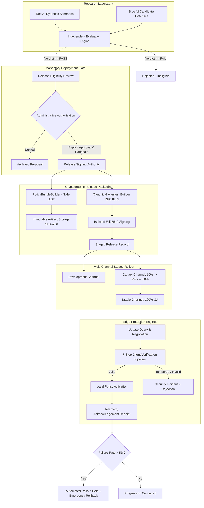

# CyberDuel AI — Signed Security Updates and Release Management System

## 1. Overview and Architecture Principles

The CyberDuel AI update and release management system bridges the cloud research laboratory (Red AI adversarial research, Blue AI countermeasures, and the Independent Evaluation Engine) with distributed edge protection engines running in the PC browser extension, mobile applications, and standalone endpoints.



### Core Security Invariants

1. **Evaluation Acceptance $\neq$ Production Deployment:**
   An automated "pass" verdict from the Independent Evaluator makes a candidate *eligible* for release consideration. It never authorizes deployment. Production publication requires explicit, auditable administrative authorization (`ReleaseApprovalService`).
2. **Zero Executable Code in Updates:**
   Policy bundles (`LocalProtectionPolicyBundle`) consist exclusively of declarative rule ASTs, safe operators (`eq`, `ne`, `gt`, `gte`, `lt`, `lte`, `contains`, `in`, `matches_regex`), pre-compiled indicator prefixes, and scoring weights. Dynamic scripts, `eval()`, bytecode, or compiled binaries are strictly prohibited and structurally rejected.
3. **Cryptographic Supply-Chain Isolation:**
   Release manifests are signed with Ed25519 private keys strictly isolated in the authority keystore. Private keys are never committed, never embedded in client packages, and never returned via APIs. Public keys are distributed as signed trust anchors (`TrustAnchorSet`).
4. **Strict Monotonic Sequencing (Anti-Replay):**
   Every release receives an incrementing sequence number ($S_{n+1} > S_n$). Clients reject any manifest with a sequence number less than or equal to their installed version, preventing downgrade and replay attacks.
5. **Verifiable Emergency Rollback:**
   When rollbacks occur, the system creates a new signed release targeting a historical known-good policy bundle, assigns a higher monotonic sequence number, and sets `is_rollback=True` and `is_mandatory=True`, guaranteeing client acceptance without violating anti-replay invariants.

---

## 2. Cryptographic Architecture

### Deterministic Canonical Serialization (RFC 8785)
To ensure digital signatures over JSON payloads are strictly reproducible across different platforms, architectures, and runtimes, CyberDuel AI implements recursive JSON canonicalization (`cyberduel_contracts.crypto.canonicalize_json`):
- Dictionary keys are sorted lexicographically at all nesting levels.
- Compact separators without whitespace (`","`, `":"`) are enforced.
- Numbers, strings, and booleans conform to standard JSON representations.
- Floating point values are formatted consistently.
- Datetimes are normalized to ISO-8601 UTC with standard `Z` suffixes.

### Digital Signature Scheme (Ed25519)
- **Algorithm:** Edwards-curve Digital Signature Algorithm over Curve25519 (Ed25519 / RFC 8032).
- **Detached Signatures:** 64-byte binary signatures represented as 128 lowercase hexadecimal characters.
- **Payload Coverage:** Manifest signatures cover all metadata fields, compatibility constraints, expiration timestamps, monotonic sequence numbers, and the canonical artifact digest. The `signature` field itself is excluded prior to canonical byte computation.

---

## 3. Seven-Step Client Verification Pipeline

Before applying any security policy update, the edge protection engine (PC browser extension or mobile companion app) executes the mandatory 7-step verification reference implementation (`ClientUpdateVerifier.verify_update`):

| Step | Verification Checkpoint | Security Threat Mitigated | Failure Action |
| :--- | :--- | :--- | :--- |
| **1** | **Trust Anchor Verification** | Compromised / Revoked Key | Immediate rejection if key is missing or listed in revoked keys |
| **2** | **Ed25519 Signature Check** | Man-in-the-Middle, Forgery | Rejects update if detached signature fails over canonical manifest |
| **3** | **Monotonic Anti-Replay** | Replay / Downgrade Attack | Rejects if `manifest.sequence_number <= client.sequence_number` (unless authorized rollback) |
| **4** | **Freshness / Expiration** | Stale Policy Injection | Rejects if `manifest.expires_at <= current_time_utc` |
| **5** | **Platform Compatibility** | Incompatible Runtime Crash | Rejects if client platform or engine version violates constraints |
| **6** | **Artifact SHA-256 Digest** | Corrupted / Tampered Payload | Computes SHA-256 of downloaded bundle bytes; requires exact hash match |
| **7** | **AST Safety & Schema Match** | Remote Code Execution | Validates declarative JSON schema; confirms `bundle.policy_version == manifest.policy_version` |

---

## 4. Multi-Channel Rollout & Staged Advancement

### Distribution Channels
1. **`development`:** Internal engineering and automated testing builds.
2. **`canary`:** Pre-release verification cohort receiving cutting-edge defensive heuristics.
3. **`stable`:** General fleet distribution for all registered devices.
4. **`emergency`:** Immediate priority channel for active incident mitigation and critical rollbacks.

### Phased Rollout Stages & Cohort Allocation
- **`internal`:** 0% distribution (laboratory and admin verification).
- **`canary_10`:** 10% target cohort.
- **`canary_25`:** 25% target cohort.
- **`canary_50`:** 50% target cohort.
- **`general_availability`:** 100% fleet distribution.

Clients are assigned to a permanent, deterministic cohort bucket ($0 \le \text{bucket} < 100$) using standard hash bucketing:
$$\text{bucket} = \left(\text{SHA-256}(\text{client\_id}) \pmod{100}\right)$$
A client receives the update if and only if $\text{bucket} < \text{rollout\_percentage}$.

### Automated Safety Circuit-Breaker
The `RolloutManager` tracks real-time client receipts (`ClientAcknowledgementRecord`). If the install failure rate exceeds 5% after a minimum sample of 10 observations:
1. Rollout is instantly paused.
2. Stage transitions to `halted`.
3. Distribution to new clients is immediately suspended.
4. Alert telemetry is recorded for security operations review.

---

## 5. REST API Specification

### Release Management Endpoints (`/api/v1/releases`)
- `POST /api/v1/releases/eligibility`: Validates candidate defense and evaluation report against quantitative gates.
- `POST /api/v1/releases/authorize`: Administrative deployment authorization, bundle compilation, and Ed25519 signing.
- `GET /api/v1/releases`: Lists releases filtered by channel and status.
- `GET /api/v1/releases/{release_id}`: Retrieves full release record, manifest, authorizations, and rollout metrics.
- `POST /api/v1/releases/{release_id}/advance`: Advances rollout stage (e.g. 10% $\to$ 25% $\to$ GA).
- `POST /api/v1/releases/{release_id}/pause`: Manually pauses rollout distribution.
- `POST /api/v1/releases/{release_id}/resume`: Resumes paused rollout.
- `POST /api/v1/releases/{release_id}/revoke`: Revokes a release immediately.
- `POST /api/v1/releases/rollback`: Initiates emergency signed rollback to a target version.

### Client Update Protocol Endpoints (`/api/v1/updates`)
- `POST /api/v1/updates/check`: Edge client update discovery query with channel and platform negotiation.
- `GET /api/v1/updates/manifests/{version_or_id}`: Downloads cryptographically signed release manifest.
- `GET /api/v1/updates/artifacts/{digest}`: Downloads immutable policy bundle bytes (`Content-Type: application/json`, `ETag`).
- `POST /api/v1/updates/ack`: Reports install outcome (`applied`, `failed`, `rolled_back`).
- `GET /api/v1/updates/trust-anchors`: Fetches public Ed25519 verification keys and revocation status.
- `GET /api/v1/updates/revocations`: Lists revoked keys and compromised releases.

---

## 6. Command-Line Interface (`scripts/release_cli.py`)

```bash
# Initialize authority signing keypair
python scripts/release_cli.py init-keys --key-id cyberduel-prod-2026-k1

# Audit candidate eligibility
python scripts/release_cli.py check-eligibility --candidate-id <UUID> --report-id <UUID>

# Authorize, build, sign, and stage release
python scripts/release_cli.py authorize \
  --candidate-id <UUID> \
  --report-id <UUID> \
  --version 2026.10.2 \
  --channel stable \
  --authorizer "secops-lead@cyberduel.internal" \
  --rationale "Evaluated against golden benchmark with 0 regressions"

# Advance staged rollout
python scripts/release_cli.py advance --release 2026.10.2 --stage canary_25

# Simulate client-side verification
python scripts/release_cli.py verify --release 2026.10.2 --client-version 0.1.0 --platform browser_extension

# Trigger emergency rollback
python scripts/release_cli.py rollback \
  --regressed-release 2026.10.2 \
  --target-version 2026.10.1 \
  --authorizer "ciso@cyberduel.internal" \
  --reason "False positive spike detected in telemetry"

# List all registered releases
python scripts/release_cli.py list
```

