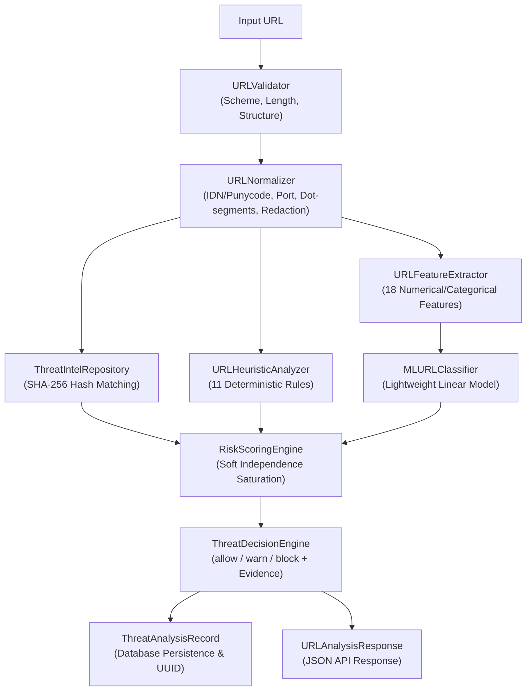
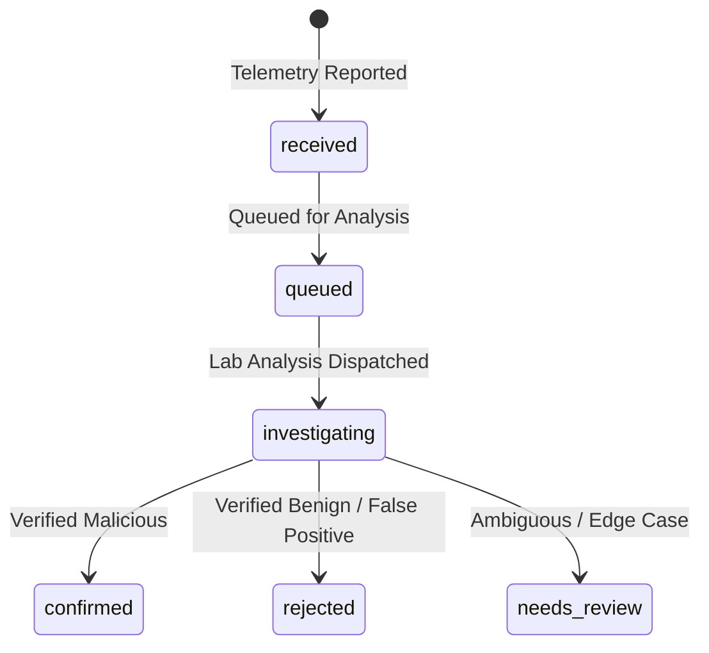

# CyberDuel AI — Threat Intelligence Engine & Explainable URL Detection

## 1. Architectural Overview

The **CyberDuel AI Threat Intelligence Engine** provides high-throughput, explainable, and privacy-preserving URL threat analysis without requiring external cloud API keys. It serves as the defensive evaluation baseline for the autonomous Red and Blue agents in later phases, as well as the engine backing the edge browser extension and mobile clients.



---

## 2. URL Normalization and Structural Validation (`cyberduel_threat_intel.normalizer`)

The normalizer transforms diverse, obfuscated, and non-canonical URL representations into deterministic `NormalizedURL` objects.

### 2.1 Handled Edge Cases
- **Scheme Enforcement:** Strictly permits `http` and `https`. Rejects non-web schemes (`javascript:`, `data:`, `file:`, `ftp:`) with specific error codes (`UNSUPPORTED_SCHEME`).
- **Whitespace & Control Characters:** Strips leading, trailing, and embedded tabs/newlines commonly used to evade basic string matching.
- **Credential Redaction:** Embedded authority credentials (`https://admin:p@ssword@evil.com`) are stripped from `canonical_url` and extracted into an isolated `has_embedded_credentials` security flag.
- **Port Canonicalization:** Default ports (`:80` for HTTP, `:443` for HTTPS) are removed. Explicit non-standard ports are validated against $[1, 65535]$.
- **Punycode & IDN Conversion:** Converts Unicode hostnames to ASCII Punycode (`xn--...`) for network identity while retaining `unicode_host` for homoglyph detection.
- **IPv4 and IPv6 Normalization:** Validates octets and bracketed IPv6 addresses (`[2001:db8::1]`), rejecting invalid IP literals.
- **Dot-Segment Resolution:** Canonicalizes `/a/b/../c/./d` path traversal sequences without resolving past the root.
- **Percent-Encoding Normalization:** Decodes safe unreserved ASCII characters (`~`, `_`, `-`, `.`) and detects nested/double percent-encoding (`%252e`).
- **Sensitive Parameter Redaction:** Automatically masks auth tokens and passwords in query strings (`token`, `api_key`, `secret`, `password`, `session_id`) using `[REDACTED]`.

---

## 3. Heuristic Rules Catalog (`cyberduel_threat_intel.heuristics`)

The engine executes 11 deterministic, transparent heuristic rules. Each emits an `EvidenceItem` with category, weight, severity, and human-readable explanation.

| Rule ID | Category | Severity | Base Weight | Target & Detection Logic |
| :--- | :--- | :--- | :---: | :--- |
| `HR-HOMOGLYPH-01` | `homoglyph` | `HIGH` | 0.85 | Detects mixed scripts (Cyrillic, Greek, Latin) in IDN domains mimicking high-value brands (e.g. `pаypal.com`). |
| `HR-EMBEDDED-CREDS-02` | `authority_spoof` | `CRITICAL` | 0.90 | Authority section contains `@` userinfo credentials designed to fool visual inspection (e.g. `https://paypal.com@attacker.com`). |
| `HR-IP-HOST-03` | `ip_address_host` | `MEDIUM` | 0.60 | Host is a raw IPv4 or IPv6 address literal bypassing DNS domain reputation. |
| `HR-BRAND-DECEPTION-04` | `brand_impersonation` | `HIGH` | 0.80 | High-value brand names appear as subdomains or path tokens on unverified second-level domains. |
| `HR-SUSPICIOUS-PORT-05` | `network_anomaly` | `MEDIUM` | 0.50 | Connection directed to non-standard HTTP/HTTPS ports (e.g. 8080, 8443, 8888, 3128, 9000). |
| `HR-DOUBLE-ENCODING-06` | `evasion_technique` | `MEDIUM` | 0.65 | Hostname or path contains `%25` sequences indicating double percent-encoding evasion. |
| `HR-HIGH-ENTROPY-07` | `domain_entropy` | `MEDIUM` | 0.55 | Hostname Shannon entropy exceeds 3.8 bits/char, characteristic of DGA (Domain Generation Algorithms). |
| `HR-EXCESSIVE-SUBDOMAINS-08` | `dns_obfuscation` | `LOW` | 0.40 | Domain contains $\ge 4$ subdomain labels designed to push registrable domain out of browser address bar. |
| `HR-EXCESSIVE-LENGTH-09` | `structural_anomaly` | `LOW` | 0.35 | URL length exceeds 255 characters or path depth exceeds 6 levels. |
| `HR-SUSPICIOUS-KEYWORDS-10` | `phishing_keywords` | `MEDIUM` | 0.60 | Path or query string contains combinations of high-risk phishing keywords (`login`, `verify`, `banking`, `wallet`). |
| `HR-KNOWN-GOOD-WHITELIST-00`| `whitelist` | `LOW` | -1.00 | Exact match against verified top-level authoritative domains (e.g. `google.com`, `github.com`), resulting in an immediate `allow` decision. |

---

## 4. Explainable Risk Scoring Engine (`cyberduel_threat_intel.scoring`)

### 4.1 Soft Independence Saturation Formula
Rather than summing raw weights (which clips at arbitrary boundaries), the engine calculates compound threat scores using soft independence saturation:

$$S = 1.0 - \prod_{i=1}^{k} \left(1.0 - w_i\right)$$

where:
- $w_i = \text{weight}_i \times \text{confidence}_i$, clamped to $[0.0, 0.98]$.
- Only the highest-severity evidence item per category is admitted (strict category deduplication).

### 4.2 Decision Thresholds
- **Allow:** Threat Score $< 0.40$
- **Warn:** $0.40 \le \text{Threat Score} < 0.70$
- **Block:** $\text{Threat Score} \ge 0.70$

### 4.3 Policy Overrides & Fail-Safe Mechanics
- **Whitelisted Target:** Bypasses scoring calculations entirely, returning score $= 0.0$ and decision $= \text{allow}$.
- **Verified Threat Intelligence Match:** Hard override returning score $\ge 0.95$ and decision $= \text{block}$.
- **Malformed Input Fail-Safe:** If an unhandled parsing anomaly occurs, the engine defaults to `Decision.WARN` with score $= 0.50$ (`fail_safe_applied=True`) to prevent fail-open security bypasses.

---

## 5. Machine-Learning Classification Interface (`cyberduel_threat_intel.classifier`)

The engine provides an optional ML inference provider backed by `URLFeatureExtractor` (extracting 18 deterministic features including length, entropy, token presence, and port indicators) and `LightweightLinearModel`:

$$\sigma(z) = \frac{1}{1 + e^{-z}}, \quad z = \text{bias} + \sum_{j} w_j f_j$$

Weights are pre-calibrated against benchmark phishing corpora and operate locally in $< 1\text{ms}$ with zero external inference costs.

---

## 6. Threat Observation & Ingestion Pipeline (`apps.api.app.services.threat_observation_service`)

Edge devices, browser extensions, and external threat feeds report suspicious activity via `POST /api/v1/threat-reports`.

### 6.1 Privacy & Redaction Controls
- Ingested URLs are hashed using SHA-256 (`normalized_target`) for indexing.
- Raw query parameters, credentials, and telemetry headers are sanitized before database storage (`password`, `token`, `secret` fields redacted).

### 6.2 Observation Lifecycle


---

## 7. Dataset Manifest & Benchmark Evaluation (`scripts/evaluate_dataset.py`)

A curated 15-record labeled dataset (`datasets/manifests/synthetic_url_dataset.json`) benchmarks the engine across diverse attacks and benign controls.

```bash
python scripts/evaluate_dataset.py --dataset datasets/manifests/synthetic_url_dataset.json
```

### Benchmark Results
- **Accuracy:** 100.00%
- **Precision:** 100.00%
- **Recall (Detection Rate):** 100.00%
- **F1 Score:** 1.0000
- **False Positive Rate:** 0.00%
- **Confusion Matrix:** TP=8, FP=0, TN=7, FN=0

