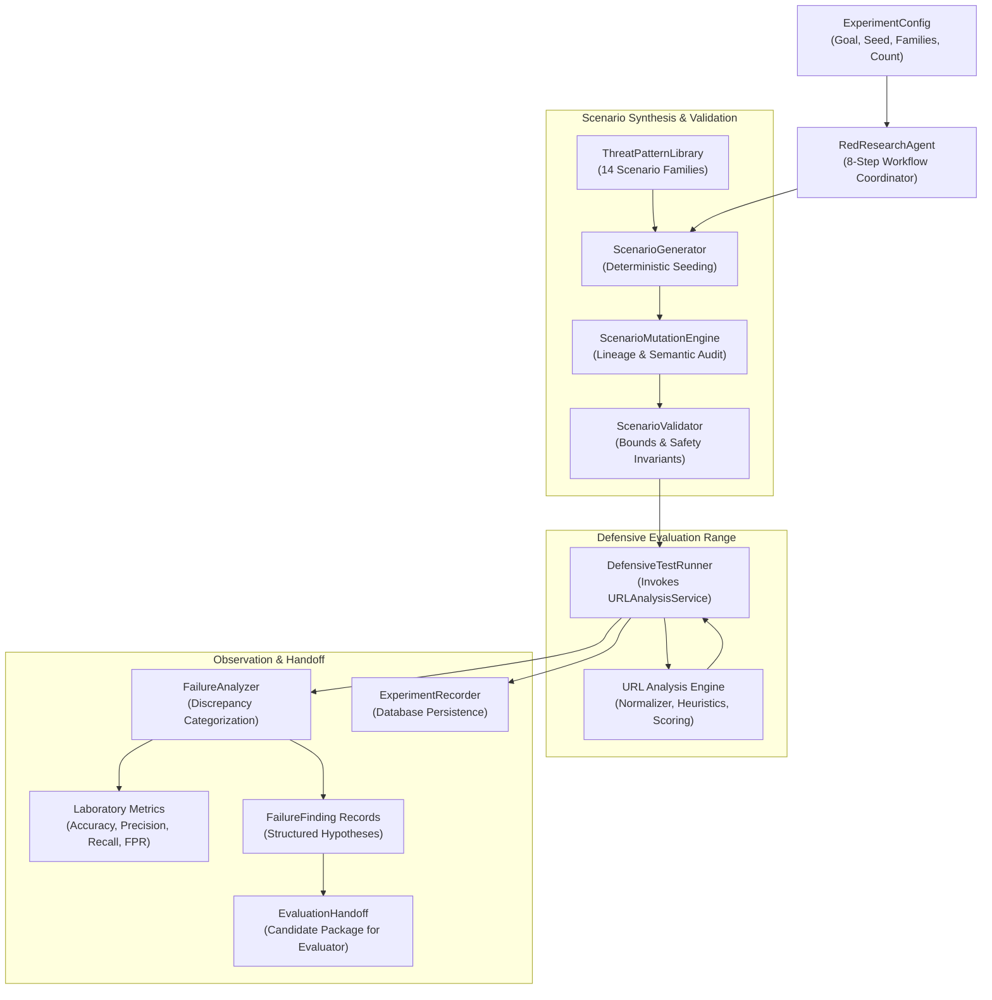

# CyberDuel AI — Red AI Research Laboratory & Sandboxed Worker

## 1. Subsystem Role & Research Mission

The **Laboratory Worker** is the controlled execution harness for the **Red AI Research Laboratory**. It conducts autonomous, reproducible adversarial security evaluations against the defensive URL detection engine.

### Core Operating Principle
> **Red AI generates experiments; it does NOT authorize production changes.**

The research laboratory tests defenses, probes detection boundaries, groups discrepancies into analytical hypotheses, and packages evidence for the future Blue AI and the Independent Evaluation Engine.

---

## 2. Strict Safety & Isolation Rules

1. **Harmless Operations Only:** The laboratory worker is strictly prohibited from executing live malware, attacking arbitrary external networks, compiling exploits, or performing unauthorized port scanning.
2. **Network Isolation:** Runs on a dedicated internal Docker network (`lab_internal_net`) with no direct route to the public internet (`internal: true`).
3. **No Host Docker Mount:** The host `/var/run/docker.sock` is never mounted into the laboratory container.
4. **Least Privilege:** Executes under an unprivileged user (`labworker`, UID 20001) with all Linux capabilities dropped (`cap_drop: [ALL]`).
5. **Resource Constraints:** Governed by strict CPU (1.0 core) and memory (512MB) limits in Compose.
6. **No External Network Access:** Generation and mutation operate exclusively on reserved test fixtures (`.test`, `.example`, `example.com`, RFC 5737 / RFC 3849 documentation IPs).

---

## 3. Red AI Architecture Breakdown



### Supported Scenario Families
1. `homograph_mimicry`: Cyrillic/Greek IDN punycode character replacement (e.g. `pаypal.example.test`).
2. `authority_spoofing`: Obfuscated `@` userinfo credentials disguising true host destination.
3. `ip_host`: Direct connections to IPv4/IPv6 documentation literals without DNS.
4. `brand_impersonation`: Brand names embedded in subdomains or path segments on unverified domains.
5. `suspicious_port`: Connections directed to non-standard HTTP/HTTPS ports (8080, 8443, 8888, 3128, 9000).
6. `double_encoding`: Nested `%25` percent-encoding evasion.
7. `dga_entropy`: Pseudo-random domain names with high Shannon entropy (>3.8 bits/char).
8. `subdomain_flooding`: Deep subdomain nesting ($\ge 4$ labels).
9. `length_anomaly`: URLs exceeding 255 characters with deep repetitive paths.
10. `phishing_keywords`: Combinations of credential theft keywords (`login`, `verify`, `banking`, `wallet`).
11. `benign_lookalike`: Essential false-positive test controls (legitimate domains referencing brand substrings or developer documentation).
12. `whitelist_control`: Authoritative domain whitelist verification (`google.com`, `github.com`).
13. `normalization_edge_case`: Mixed casing, explicit default ports, and dot-segment traversals.
14. `stale_intelligence`: Expired and retired threat indicator records.

---

## 4. Laboratory CLI Commands (`scripts/lab_cli.py`)

The CLI provides researcher tools to generate, validate, execute, inspect, and reproduce experiments:

```bash
# 1. Generate a 100-scenario synthetic corpus
python scripts/lab_cli.py generate --count 100 --seed 42 --output datasets/manifests/synthetic_scenario_corpus.json

# 2. Validate scenario manifest against safety constraints
python scripts/lab_cli.py validate --input datasets/manifests/synthetic_scenario_corpus.json

# 3. Execute an adversarial experiment locally against the defensive engine
python scripts/lab_cli.py run --name "Adversarial Homoglyphs and Controls" --goal "Test Cyrillic Homoglyphs" --count 50 --seed 42 --output datasets/manifests/example_experiment_report.json

# 4. Inspect an experiment report
python scripts/lab_cli.py report --file datasets/manifests/example_experiment_report.json

# 5. Reproduce an experiment deterministically from its recorded seed
python scripts/lab_cli.py reproduce --seed 42 --count 50 --goal "Test Cyrillic Homoglyphs"
```

---

## 5. REST API Endpoints (`/api/v1/lab`)

| Method | Endpoint | Description |
| :--- | :--- | :--- |
| `GET` | `/api/v1/lab/status` | Discover worker health, active experiment counts, and supported families. |
| `POST`| `/api/v1/lab/scenarios/generate` | Generate a batch of validated synthetic scenarios without running an experiment. |
| `POST`| `/api/v1/lab/experiments` | Create and execute an adversarial experiment. |
| `GET` | `/api/v1/lab/experiments/{id}` | Retrieve experiment summary, metrics, and findings by UUID. |
| `GET` | `/api/v1/lab/experiments/{id}/results` | Retrieve individual scenario execution observations. |
| `POST`| `/api/v1/lab/experiments/{id}/cancel` | Cancel an in-flight experiment. |
| `GET` | `/api/v1/lab/scenarios` | List cataloged scenarios with optional family filter. |
| `GET` | `/api/v1/lab/scenarios/{id}` | Retrieve specific scenario contract by UUID. |
| `GET` | `/api/v1/lab/metrics` | Retrieve aggregated detection and discrepancy metrics. |

---

## 6. Handoff Contract for Blue AI & Independent Evaluator

When an experiment completes, `EvaluationHandoff` emits an `EvaluationHandoffPackage`:
- `handoff_id`: UUID
- `experiment_id`: Reference to the executed experiment
- `candidate_id`: Token identifying the failure candidate set
- `detector_version` & `policy_version`: Active baseline during test
- `total_failures`: Discrepancy count
- `findings`: List of `FailureFinding` instances (category, discrepancy type, hypothesis, suggested remedy, representative scenario IDs)
- `representative_scenarios`: Full `ScenarioContract` definitions of failing test cases
- `ground_truth_confidence`: Float (default 0.95)
- `reproduction_config`: Configuration dictionary allowing exact regeneration
- `suggested_investigation_questions`: Actionable questions for Blue AI defense formulation
